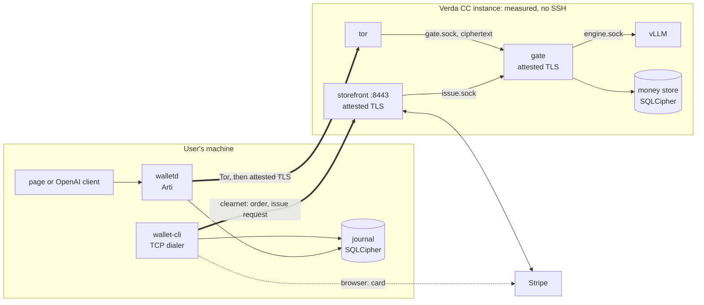
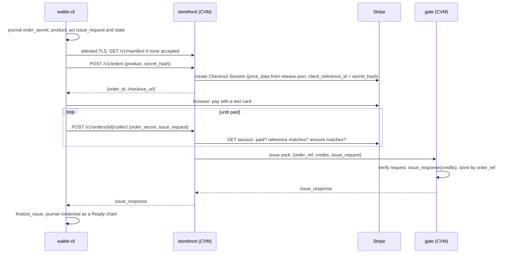
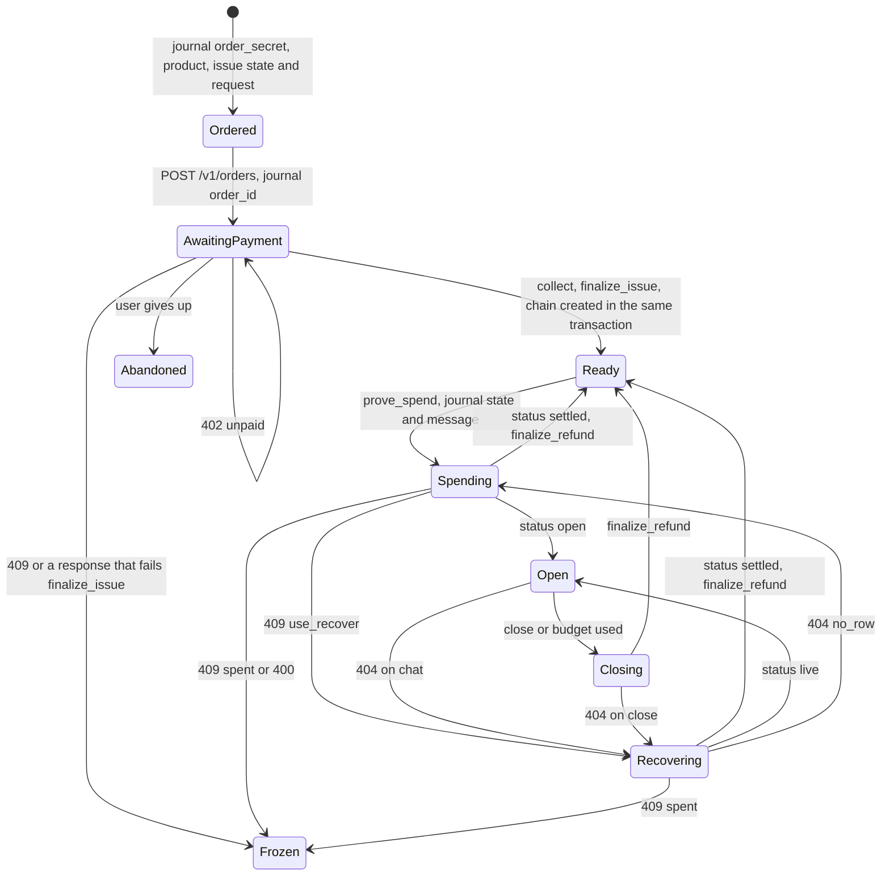

# Counteractive architecture

Status: **decided architecture for the PoC**, 7 November 2026. It applies the six decisions in [section 2](#2-decisions) to the proposal in [`docs/architecture/`](docs/architecture/README.md), which holds the deeper detail per component. Where the two disagree, this file wins. A local prototype of this design lives in [`prototype/`](prototype/), and [section 14](#14-validation-status) records what it has and hasn't shown.

Evidence tags follow the [docs README](docs/architecture/README.md#evidence-labels): [tested], [read], [resolver], [inferred], [unknown].

## 1. What the service promises

> A user buys credit by card over ordinary HTTPS. That purchase is identified. Everything after it, meaning which model they use, what they send, how much they use and when, happens over Tor, inside an attested confidential VM, and is paid for with credentials the issuer can't link back to the purchase. Usage is metered per token and settled exactly, with change returned as a new credential.

The thing to hide is **usage**. Purchase is allowed to be identified. Two mechanisms carry this:

- **EC-ACT credentials.** The issuer signs a credit balance without learning the credential's nullifier, so a later spend can't be linked to the issuance or to earlier spends. The draft's words: "the issuer cannot correlate credit issuance with spending". [read: `draft-schlesinger-cfrg-act-01` lines 23-24, and the `act-rs` crate docs] This holds only if every wallet uses the same context, which the compiled-in pins ensure.
- **Tor plus attested TLS.** The gate never sees the wallet's IP, and only measured code sees prompts.

It is confidential inference with IP hiding at weak anonymity, not strong anonymity. With few users, purchase and use times and amounts can correlate. Card refunds, disputes and small-anonymity-pool effects are out of scope by decision ([section 13](#13-accepted-limits)).

## 2. Decisions

| # | Decision | Consequence |
|---|---|---|
| 1 | **EC-ACT** credentials (`act-rs`), held and verified by the gate inside the CVM | Exact per-token settlement with hidden balances. The gate holds the issuer key at runtime. |
| 2 | **Operator-held key K** opens the money store and the issuer seed | Every restart needs an unlock. The operator can mint, as the operator could anyway. |
| 3 | **Storefront on the same instance**, as its own process on its own TCP port (8443) | No second server. The CVM gets one clearnet inbound port and outbound HTTPS for one user. |
| 4 | **Stripe sandbox only** | Test cards only. Live keys need Stripe's approval for stored value first. |
| 5 | **Rust** for every component we write | One workspace; `act-rs`, Arti and `sev` are all Rust. |
| 6 | **Issuance on the purchase plane**, over clearnet, at purchase time | The RFC 9578 blind-RSA voucher layer is removed. Blind EC-ACT issuance already gives the unlinkability the voucher was there for. |

Decision 6 is the large simplification. The voucher existed only to move issuance onto Tor. With issuance allowed on clearnet, it adds a second signature scheme on a release-candidate `rsa` crate, a token format, per-denomination keys, a voucher table, a retention and purge policy, key rotation that killed unredeemed vouchers, and a separate stolen-key check, while protecting nothing EC-ACT doesn't already protect.

Unchanged from the proposal: exact settlement (not a refund grid), SQLCipher money store, C tor onion service with an embedded Arti client, inner TLS bound to attestation, vLLM on a Unix socket, a minisign-signed manifest that the user approves, a compiled-in session tier ladder, and a full refund for any session a gate crash interrupts.

## 3. Components and where they run

| Component | Runs on | Job | Network |
|---|---|---|---|
| `wallet-cli` | User's machine | Buys credit, receives credentials, prints balance, drives `walletd` | Clearnet TCP to the storefront only |
| `walletd` | User's machine | Spends credentials over Tor, serves an OpenAI-compatible API and a small page with the model selector and balance on localhost | Tor to the gate only |
| Stripe Checkout | Stripe | Takes the card | Browser to Stripe |
| **Storefront** | **Inside the CVM**, user `storefront` | Creates Checkout sessions, confirms payment with Stripe, asks the gate to issue | Inbound TCP 8443, outbound HTTPS to Stripe, Unix socket to the gate |
| **Gate** | Inside the CVM, user `gate` | Inner TLS, attestation, issuance, sessions, metering, refunds. Holds the issuer key while unlocked. | None: Unix sockets only |
| Engine (vLLM) | Inside the CVM, user `engine` | Runs the model on the GPU | None: Unix socket only |
| C `tor` | Inside the CVM | Onion service forwarding to the gate's socket. Sees only inner-TLS ciphertext. | Tor relays |
| Boot collector | Inside the CVM, boot only | Fetches AMD collateral, runs `nvattest` | HTTPS at boot, then locked down |
| `xtask` | Operator's machine | Builds, measures, signs, deploys, unlocks gate and storefront | Verda API, Tor to gate, clearnet to storefront |

## 4. System picture



The purchase plane and the use plane meet only inside the gate, at issuance, and what crosses is a blinded EC-ACT issue request. Nothing that later appears on the use plane (nullifier, spend, prompt) is derivable from it.

## 5. External software in the data flow

Versions and the reasoning behind each are in [docs 02](docs/architecture/02-third-party-dependencies.md). Rows marked new or changed reflect the decisions.

| Flow step | External software | What it does for us |
|---|---|---|
| Card payment | Stripe Checkout and API (sandbox) | Card UI, 3-D Secure, fraud screening, PCI scope reduced to SAQ A |
| Issuance, spending, refunds | `act-rs` 0.1.0 at `0fe1d8f7` | EC-ACT on P-256: blind issuance, hidden balance, spend proofs with change |
| Anonymous transport | `arti-client` in `walletd`; C `tor` in the CVM | Onion client and onion service with proof-of-work |
| Inner channel, both planes (changed) | `rustls`, `tokio-rustls`, `rcgen` | TLS 1.3 whose key is bound into the attestation report, for the gate over Tor and the storefront over clearnet |
| HTTP | `hyper`, `axum`; `reqwest` in the storefront only (changed) | Servers, and the storefront's one outbound client, to Stripe |
| Sealing results at rest | `hkdf`, `chacha20poly1305` | Refunds sealed under a key only the spend's owner can re-derive |
| CPU attestation | AMD SEV-SNP, AMD KDS, `sev` crate | Reports, VCEK chain, parsing and checks |
| GPU attestation | NVIDIA `nvattest`, RIM and OCSP services | GPU appraisal inside the measured boot |
| Release signing | `minisign`, `minisign-verify`, `actions/attest` | Manifest signed offline, checked by wallets; public log for auditors |
| Measurement prediction | `sev-snp-measure`, `sev::measurement` | Expected launch digest, computed twice |
| Image | mkosi, Ubuntu packages, `modelwrap`, dm-verity | Read-only root and model with hash trees |
| Inference | vLLM, PyTorch, NVIDIA driver and CUDA, Qwen3-0.6B | The model |
| Durable state | `rusqlite` with bundled SQLCipher | Money store and wallet journal, encrypted at rest |
| Hosting | Verda API | Create, start and stop CC instances |
| Local testing | fake engine, fake Stripe, `llama-server` optional | The same interfaces with no GPU, card or network |

**Removed by decision 6:** `blind-rsa-signatures`, `rsa =0.10.0-rc.21` and its RUSTSEC-2023-0071 exception, the RFC 9474 and 9578 test vectors, the Stripe webhook and its HMAC code, `stripe listen`, and a reverse proxy in front of the storefront.

## 6. Flows

### 6.1 Boot and unlock

1. The measured image boots. The collector fetches AMD collateral and runs `nvattest`; the gate refuses to start if the GPU appraisal failed. The firewall switches to the runtime ruleset ([section 12](#12-image-and-deployment)).
2. Gate and storefront each generate a TLS key in memory and obtain evidence binding it, with their role, into an SNP report.
3. `xtask unlock` attests the gate over Tor and sends K with the signed manifest. On first deployment the gate creates the store and issuer seed and returns the issuer public key, the operator signs a manifest containing it, and posts that manifest. The gate is then Ready.
4. `xtask unlock` attests the storefront over clearnet and sends the Stripe restricted key, authenticated by a storefront operator token whose hash `release.json` pins. The key is held in memory only.

### 6.2 Purchase and issuance (clearnet)



- **The storefront stores nothing.** Stripe holds the order, and the gate holds the issuance record. `order_id` is the Checkout Session ID, and `client_reference_id` is `SHA-256(order_secret)`, so only the wallet that created the order can collect it.
- **No webhooks.** Collect asks Stripe for the session directly, so the CVM needs no inbound connection from Stripe, no webhook secret and no public certificate.
- **Products come from `release.json`**, which is measured: `{id, usd_cents, credits}`. The storefront sends `price_data` inline, so no Stripe Price objects need creating. The gate refuses a `credits` value that isn't a listed product.
- **Retries are exact.** The gate keys issuance by `order_ref = SHA-256(order_id)` and stores the request hash and response. The same request gets the same response; a different request for the same order gets `409 order_issued`. Nothing is purged, so there's no retry window.
- **What the purchase plane learns:** the user's IP, card identity (Stripe), amount, time, and a blinded issue request. None of that links to a nullifier.

### 6.3 Inference session (Tor)

Unchanged from [docs 01 section 4.6](docs/architecture/01-system-and-data-flow.md#46-inference-session-tor) and [docs 05 section 5](docs/architecture/05-component-gate.md#5-request-flows):

1. `walletd` connects through Arti to the onion service, completes inner TLS, fetches evidence for a fresh nonce, and checks it against the accepted manifest before sending any secret.
2. It picks a Ready chain, chooses `s` from the compiled-in ladder, journals the spend state and message, and sends `POST /v1/sessions {spend}`.
3. The gate checks the nullifier, verifies the proof, commits a Pending row, and opens a session with budget `s`.
4. Each turn: the gate counts prompt tokens, holds `in_rate × prompt + out_rate × allowed_output`, streams from the engine, debits the actual count, and ends with a receipt (counts, charge, remaining, finish reason).
5. Close (by the wallet, idle timer, turn limit or age limit): `t = s − debits`, refund issued, sealed and committed by compare-and-set, then returned. The wallet finalises it into a new credential.

### 6.4 Crash and recovery

A lost response is retried with the same bytes. A gate crash leaves a Pending row with no live slot, so `recover` with the original spend refunds `t = s` in full, once. The admission and recover tables in [docs 05 section 5](docs/architecture/05-component-gate.md#5-request-flows) define every interleaving, and the wallet's failure table in [docs 04 section 8](docs/architecture/04-component-wallet.md#8-failure-handling) defines its reaction to each response. An issuance response lost on the purchase plane is retried with the same `issue_request`, which returns the stored response.

### 6.5 Updates

Drain, export the store over Tor, boot the new image, attest, import, unlock, as in [docs 07 section 9](docs/architecture/07-enclave-image-and-deployment.md#9-updating-a-running-service). The storefront has no state to move, so it only needs its Stripe key again. Purchases are refused while the gate isn't Ready.

## 7. What each party can see

| Party | Sees | Doesn't see |
|---|---|---|
| Stripe | Card, email, IP, amount, time, and a hash of the order secret | Anything about use |
| Storefront code | User's IP, order, product, and the blinded issue request and response | Nullifiers, spends, prompts |
| Gate code | Prompts, outputs, token counts, `s`, nullifiers; at issuance, the order hash and product | Which issuance a spend came from; the wallet's IP on the use plane |
| Operator with K and the Stripe account | Everything Stripe and the store hold: purchases by identity, issuance rows by order, nullifiers and pending state. Can mint credit. | Which purchase funded which session; `t` at rest; prompts, unless they sign a malicious release |
| Verda host | Clearnet purchase connections and Tor traffic for the same instance, GPU and disk timing, the onion key | Memory and prompts, if SNP and GPU-CC hold |
| Local network | That the user contacted the instance's IP, and separately that they run Tor | Contents of either |

Running the storefront on the same instance doesn't change what one operator sees, because the same person held both servers before. It does mean the host sees both planes on one machine, which makes timing correlation at small scale slightly easier ([limit 2](#13-accepted-limits)).

## 8. Code architecture

### 8.1 Workspace

```text
crates/
├── proto/          wire types for gate, storefront and local APIs; OpenAI subset; SSE splitter
├── credit/         wraps act-rs: Moderator (gate) and Holder (wallet); the only crate naming act types
├── manifest/       manifest and release.json types, canonical JSON, signature check, accept rule
├── attest/         evidence bundle, ReportBinding with role, verifiers: dev-insecure, snp
├── metering/       hold, clamp, debit, receipt arithmetic
├── backend/        InferenceBackend: openai-compatible adapter (vLLM, llama.cpp, fake)
├── gate-conn/      Dialer (Unix, TCP, Arti behind a feature), UnverifiedConn, AttestedConn
├── crash-point/    crash_point! macro for kill tests
├── gate/           the CVM service: states, API, store, sessions, issuance socket
├── storefront/     the CVM purchase service: orders API, Stripe client, issue.sock client
├── wallet-core/    journal, chain state machine, reconcile; no network
├── wallet-cli/     purchase and issuance over the TCP dialer; drives walletd
├── walletd/        Tor sessions over the Arti dialer; local OpenAI API and page
├── fake-engine/    deterministic OpenAI-compatible engine for tests
└── fake-stripe/    the two Checkout endpoints plus a test "pay" call
xtask/              keygen, manifest, unlock, deploy, e2e
image/              mkosi config, units, firewall, torrc
```

`voucher/` is gone. `fake-stripe/` is new, so tests exercise the storefront's real HTTP client against a local server.

### 8.2 Layering rules

1. **Domain crates do no IO**: `proto`, `credit`, `manifest`, `attest` (verification), `metering`. They take bytes and `now`, and return values.
2. **Third-party crypto stays behind one crate.** Only `credit` names `act-rs`. Only `attest` names `sev`.
3. **Services hold sockets and state, and little else.** Handlers parse, call a domain function, persist, respond.
4. **Secrets use `secrecy` types** with no `Debug`: K, issuer seed, spend bytes, client states, the Stripe key, the storefront token.
5. **Two network stacks in the wallet, never mixed.** `wallet-cli` has only the TCP dialer; `walletd` has only the Arti dialer. `gate-conn` exposes them as separate features, and a `cargo tree` check in CI fails if `arti-client` appears under `wallet-cli` or a TCP dialer under `walletd`. `wallet-cli` asks `walletd` over localhost for anything on the use plane.
6. **The gate has no outbound client.** It listens on two Unix sockets: `gate.sock` for tor (inner TLS) and `issue.sock` for the storefront (local, no TLS, group-restricted).

### 8.3 Key abstractions

```rust
// credit: the gate's side. No IO.
impl Moderator {
    pub fn from_seed(seed: &SecretSeed, ctx: &ServiceContext) -> Result<Self, CreditError>;
    pub fn public_key(&self) -> IssuerPublicKey;
    pub fn issue(&self, credits: u64, request: &[u8]) -> Result<Vec<u8>, CreditError>;
    pub fn peek_nullifier(&self, spend: &[u8]) -> Result<Nullifier, CreditError>;
    pub fn verify_spend(&self, spend: &[u8]) -> Result<SpendFacts, CreditError>; // rejects allowance != 0
    pub fn refund(&self, spend: &[u8], t: u64) -> Result<Vec<u8>, CreditError>;
}

// credit: the wallet's side. Every state has a byte encoding, so it can be journalled first.
impl Holder {
    pub fn issue_request(&self) -> Result<(IssueState, Vec<u8>), CreditError>;
    pub fn finalize_issue(&self, state: IssueState, response: &[u8]) -> Result<Credential, CreditError>;
    pub fn prove_spend(&self, cred: Credential, s: u64) -> Result<(SpendState, Vec<u8>), CreditError>;
    pub fn finalize_refund(&self, state: SpendState, refund: &[u8]) -> Result<Credential, CreditError>;
}

// attest: the binding now names the role, so a storefront report can't stand in for the gate.
pub struct ReportBinding {
    pub role: Role,                    // Gate | Storefront
    pub tls_spki_sha256: [u8; 32],
    pub gpu_evidence_sha256: [u8; 32],
    pub wallet_nonce: [u8; 32],
}

// gate-conn: secrets can only be sent on a connection that passed attestation.
impl UnverifiedConn { pub async fn fetch_manifest(&mut self) -> Result<SignedManifest, ConnError>;
                      pub async fn attest(self, v: &dyn AttestationVerifier, role: Role, ...) -> Result<AttestedConn, Rejection>; }

// backend: the engine axis.
pub trait InferenceBackend: Send + Sync {
    fn describe(&self) -> BackendCapabilities;
    async fn count_prompt(&self, req: &EngineRequest) -> Result<u32, BackendError>;
    async fn start(&self, req: EngineRequest, limit: OutputLimit) -> Result<EngineStream, BackendError>;
}

// storefront: the payment axis. Stripe in production, fake-stripe in tests, same HTTP code.
pub trait PaymentProvider: Send + Sync {
    async fn create_checkout(&self, product: &Product, reference: &str) -> Result<Checkout, PayError>;
    async fn get_checkout(&self, id: &str) -> Result<CheckoutStatus, PayError>;
}
```

The platform axis (`AttestationSource`, `AttestationVerifier`), `KeyCustody` and `MoneyStore` are as in [docs 03 section 5](docs/architecture/03-code-architecture.md#5-key-abstractions), with `record_voucher` replaced by `record_issue(order_ref, request_hash, response)`.

## 9. Gate

States, API and flows are as in [docs 05](docs/architecture/05-component-gate.md), with issuance moved to the local socket.

| Socket | Endpoint | Purpose |
|---|---|---|
| `gate.sock` (inner TLS, via tor) | `GET /v1/health`, `GET /v1/manifest`, `POST /v1/attestation` | Public, before attestation |
| | `POST /v1/sessions`, `/v1/sessions/{id}/chat`, `/v1/sessions/{id}/close`, `/v1/sessions/recover` | Use plane |
| | `/v1/operator/*` (unlock, manifest, import, drain, export, state) | K as bearer |
| `issue.sock` (local, storefront only) | `POST /local/issue {order_ref, credits, issue_request}` | Issuance: `{issue_response}`, `400`, `409 order_issued`, `503 locked`, `503 low_disk` |

```sql
CREATE TABLE issuer (id INTEGER PRIMARY KEY CHECK (id = 1), seed BLOB NOT NULL,
                     key_epoch INTEGER NOT NULL, manifest_version INTEGER NOT NULL DEFAULT 0);
CREATE TABLE issued (order_ref BLOB PRIMARY KEY, request_sha256 BLOB NOT NULL,
                     response BLOB NOT NULL) WITHOUT ROWID;
CREATE TABLE spend  (nullifier BLOB PRIMARY KEY, sealed_refund BLOB) WITHOUT ROWID; -- NULL = Pending
```

Issuance order: check state and disk reserve, look up `order_ref` (same request hash returns the stored response, a different one returns `409`), check `credits` against the product list, `verify_issue_request`, `issue_response`, commit, return. The `issued` row isn't sealed, because issuance is identified by design and the response is useless without the wallet's state.

Sessions keep the slot table (`Reserving`, `Open`, `Closing`), compare-and-set settlement, the one-debit rule and the recover table exactly as in docs 05, including the fixes from the last trace: the closing task retries its own disk write, recover reads slot and store under the slot lock, and imports use generation directories so a stale `-wal` can't replay onto a new store.

## 10. Storefront

| Endpoint | Request | Response | Errors |
|---|---|---|---|
| `GET /v1/health` | | `{state}` | |
| `GET /v1/manifest` | | manifest and signature | `503` |
| `POST /v1/attestation` | `{nonce}` | evidence with role `storefront` | `503 busy` |
| `POST /v1/orders` | `{product, secret_hash}` | `{order_id, checkout_url}` | `400`, `429`, `503 unconfigured` |
| `POST /v1/orders/{id}/collect` | `{order_secret, issue_request}` | `{issue_response, credits}` | `401`, `402 unpaid`, `404`, `409 order_issued`, `503 locked` |
| `POST /v1/operator/configure` | `{stripe_key}`, storefront token as bearer | `{ok}` | `401` |

```text
crates/storefront/src/
├── main.rs        startup, TLS, listener on :8443
├── config.rs      products from release.json, token hash
├── stripe.rs      create and retrieve Checkout Sessions (PaymentProvider over reqwest)
├── gate.rs        issue.sock client
├── tls.rs         per-boot key, evidence with role Storefront
└── api.rs         the endpoints above
```

Collect checks, in order: `SHA-256(order_secret)` equals the session's `client_reference_id` (`401`), `payment_status` is `paid` (`402`), `metadata.product` names a product whose `usd_cents` and currency match `amount_total` (`409`), then calls the gate. Raw Stripe responses are never logged, and `customer_details` is never parsed.

**Checkout parameters:** `mode=payment`, one line item with `price_data` (`currency=usd`, `unit_amount`, product name), `client_reference_id`, `metadata[product]`, `success_url` pointing at `walletd`'s local page (`http://127.0.0.1:<port>/paid`), which only says to return to the wallet. No customer, no email field set by us. Stripe still asks for an email.

**The browser never visits the storefront.** The wallet talks to it over attested TLS, so no domain name or public certificate is needed. A browser-facing storefront page would need both, on port 443; that's deferred.

## 11. Wallet

As in [docs 04](docs/architecture/04-component-wallet.md), with purchase and issuance merged:



The issue request and state are generated once, journalled before the first send, and never regenerated, so a retry always sends identical bytes. The manifest can be fetched from the storefront during a purchase, because that moment is already identified; at use time it's fetched only over Tor. Either way a fetched manifest stays pending until the user approves it.

The balance view, tier ladder (placeholders 500,000 / 50,000 / 5,000 credits), exhaustion handling and reconcile classification are as in docs 04 sections 7 and 10, minus voucher rows. `walletd`'s page offers the model selector (from `GET /v1/models`), a streaming chat, and the balance with a reconcile button.

## 12. Image and deployment

As in [docs 07](docs/architecture/07-enclave-image-and-deployment.md), with these changes.

**Units.** `storefront.service` runs as user `storefront`, `After=gate.service`, with `ProtectSystem=strict`, no access to `/run/gate/gate.sock`, the store or the engine socket, and membership in the group that owns `issue.sock`.

**Firewall at runtime** (sketch, untested):

```text
chain input  { policy drop; iif lo accept; ct state established,related accept;
               udp sport 67 udp dport 68 accept; tcp dport 8443 accept }
chain output { policy drop; oif lo accept; udp sport 68 udp dport 67 accept;
               meta skuid "debian-tor" meta l4proto tcp accept;
               meta skuid "storefront" udp dport 53 accept;
               meta skuid "storefront" tcp dport { 53, 443 } accept }
```

Gate and engine keep `PrivateNetwork=yes`, so the storefront rules can't reach them.

**`release.json`** drops `voucher_keys` and `token_challenge_digest`, and adds:

```json
{
  "products": [{"id": "usd-5", "usd_cents": 500, "credits": 5000000}],
  "storefront": {"port": 8443, "operator_token_sha256": "hex"}
}
```

**Manifest.** `service` gains nothing new; the storefront address is compiled into the wallet beside the onion address, as a manifest can't be allowed to choose where a wallet connects. Products and prices come from the attested release config, so what a user is charged stays part of what's measured.

**First deployment** adds one step after the gate is Ready: `xtask unlock` configures the storefront. **Every restart** needs both unlocks, which `xtask unlock` does together.

## 13. Accepted limits

The full list is [docs 01 section 6](docs/architecture/01-system-and-data-flow.md#accepted-limits). These change or are new:

1. **Card refunds and disputes are out of scope.** In-session change is in scope. [your decision]
2. **No anonymity claim at small scale.** Purchase and first use can be correlated by time and amount, and the host now sees both planes on one instance. [your decision]
3. **One person holds every root**: the minisign key, K, the storefront token, the Stripe account and the Verda account. (Voucher keys are gone.)
4. **A compromised storefront can mint.** It can call `issue.sock` with any listed product, which is the same power a stolen voucher key had. Comparing Stripe's paid sessions with `issued` rows, using K, detects it after the fact. It can't read prompts without also escaping its user account inside the VM. [inferred]
5. **The CVM now has a clearnet-facing HTTP server.** That's more attack surface inside the trusted boundary than a Tor-only image, mitigated by user separation, `PrivateNetwork` on gate and engine, and a small handler set. [inferred]
6. **Purchases depend on the gate.** While the gate is Locked, Draining or down, collect returns `503 locked`; a paid order stays collectable indefinitely.
7. **Verda networking is unverified for this.** Whether an inbound port beyond SSH reaches a CC instance, and whether its public IP survives Shutdown and Start, are M0 checks. If the IP changes, wallets need a DNS name pinned instead, which still needs no certificate. [unknown]

Unchanged and still important: rollback by the host (limit 8), EC-ACT being an unreviewed draft (10), no unattended restart (11), full refund on crash (12), the host holding the onion key (15), a stolen issuer secret being undetectable (19), and the unresolved Verda 24-hour NVIDIA clause (18).

## 14. Validation status

| Claim | Status |
|---|---|
| `act-rs` issue, spend, refund round trip; sizes and timing | [tested on a laptop]: L=24 spend 3,499 B, verify about 6.9 ms; L=32 4,531 B, about 9 ms |
| EC-ACT issuance is unlinkable to spends | [read] in the draft and crate docs; no outside review |
| The components work together, locally | [tested on a laptop], 7 November 2026: all 12 end-to-end steps in [`prototype/SPEC.md`](prototype/SPEC.md) pass with the real binaries as separate processes, plus a 13th step of kill tests, and 226 unit and integration tests pass. The wallet page was checked by hand in Chrome. Details, review fixes and gaps are in [`prototype/README.md`](prototype/README.md) |
| Clearnet purchase and blind issuance through `issue.sock` | [tested on a laptop] against fake-stripe: unpaid gives 402, a repeated collect returns identical bytes, a different request gives 409, a wrong order secret gives 401 |
| Metering, refunds and recovery | [tested on a laptop]: balances match exactly after every step; replay and a gate SIGKILL recover byte-identical refunds |
| Two-stack rule | [tested]: `cargo tree` shows no `arti-client` in `wallet-cli`, no `reqwest` or TCP dialer in `walletd`, neither in the gate |
| C tor onion service with embedded Arti | [tested on a laptop] over the live Tor network: tor 0.4.9.16 published the gate's onion service, and `walletd` on Arti passed end-to-end steps 3 to 10 through it (purchase, chat, close, replay, gate crash, idle close, budget errors) in two runs. `walletd` redials once on a fresh circuit when a connection fails before any request is sent |
| Crash recovery | [tested on a laptop]: ten crash points across the gate, `wallet-cli`, `wallet-core` and `walletd`. Each kills its process at that point; after a restart, retries resend the journalled bytes and the balance is exact |
| Manifest approval binding | Not yet: approving a manifest isn't bound to the one reviewed |
| Stripe sandbox flow with a real test key | Implemented (`xtask up --real-stripe`), never called; needs a sandbox key from you |
| SEV-SNP and GPU attestation, custom image, vLLM on CC | Not started; needs a Verda instance (M0, about $3-6) |
| Inbound port and IP stability on Verda CC | Unknown until M0 |

Milestones are in [docs 08 section 5](docs/architecture/08-decisions-and-validation.md#5-milestones). With vouchers removed, M2 shrinks to the Stripe sandbox flow alone.
