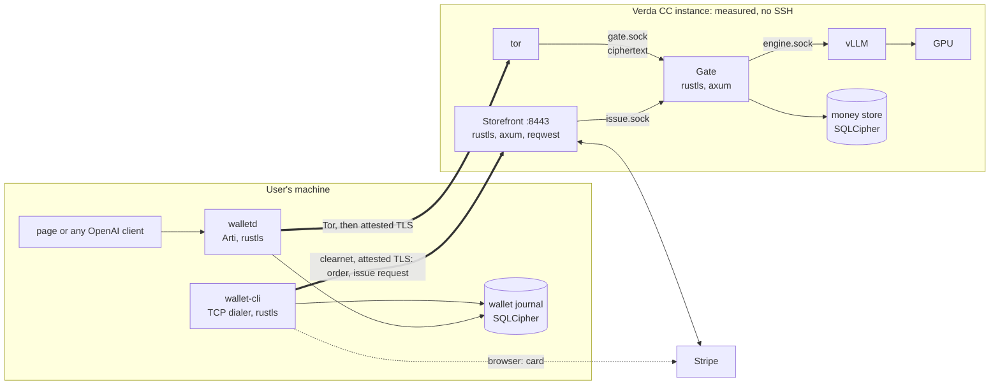
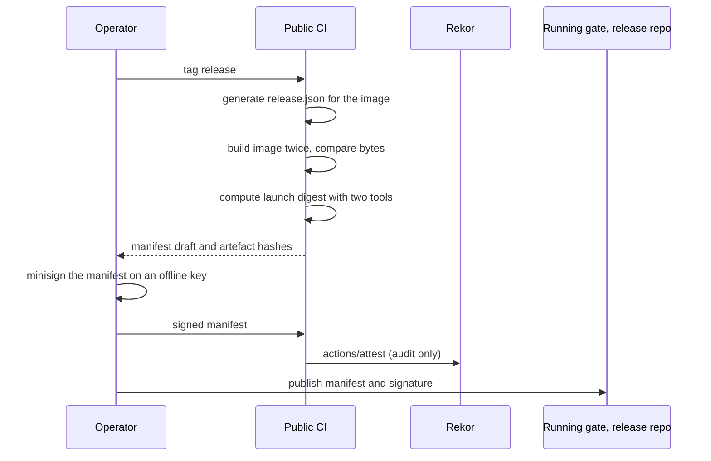
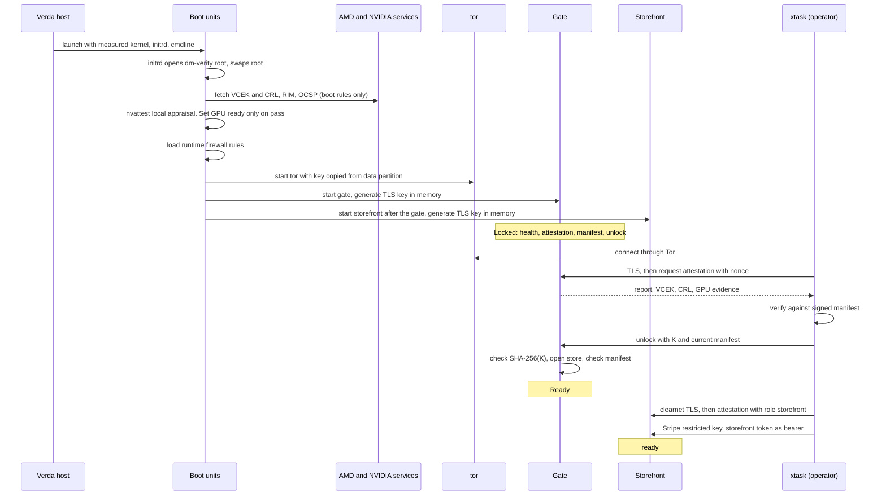
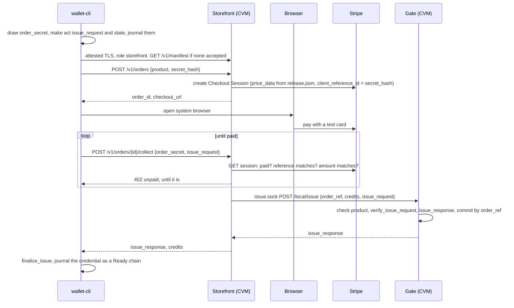
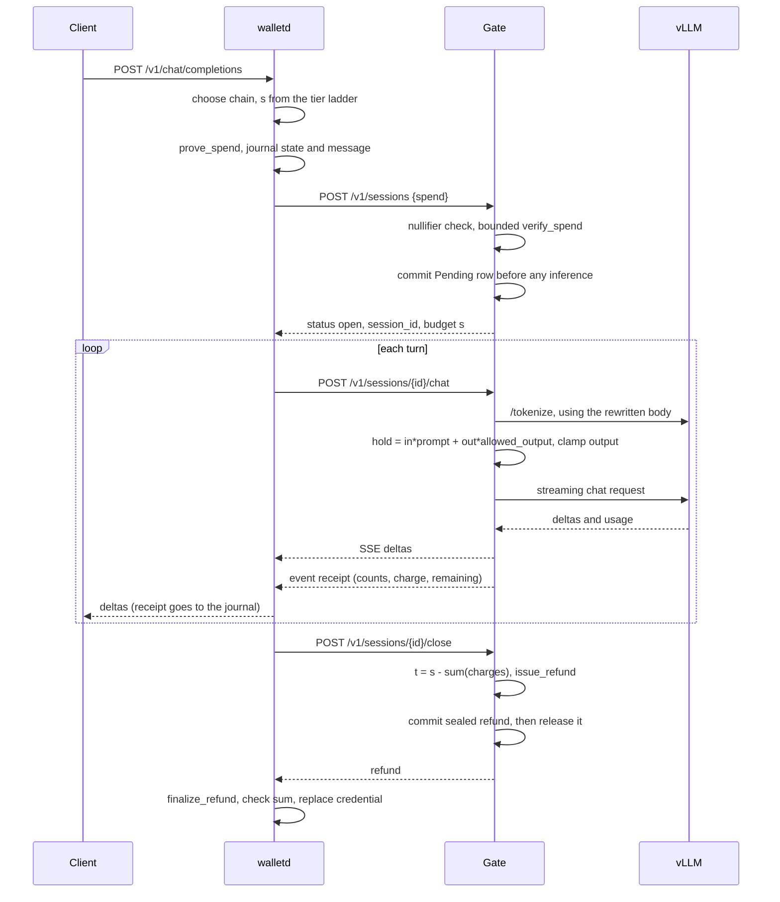

# 01. System and data flow

This document covers which programs exist, where they run, what crosses each boundary, and what each party can see. The top-level statement is [`ARCHITECTURE.md`](../../ARCHITECTURE.md), which wins where the two disagree. Code structure is in [03](03-code-architecture.md). Evidence tags are defined in the [README](README.md#evidence-labels).

## 1. Components and where they run

| Component | Runs on | Written by | Job |
|---|---|---|---|
| `wallet-cli` | User's machine | Us | Buys credit and receives credentials over clearnet, with attested TLS to the storefront. Never touches Tor. Asks `walletd` over localhost for anything on the use plane. |
| `walletd` | User's machine | Us | Talks to the gate over Tor. Serves an OpenAI-compatible API and a small page with the model selector and balance on localhost. |
| Stripe Checkout | Stripe | Stripe | Takes the card. Card data never reaches our servers. |
| Storefront | Inside the confidential VM (CVM), as user `storefront`, on TCP port 8443 | Us | Terminates its own attested TLS, creates Stripe Checkout sessions, confirms payment by polling Stripe, and asks the gate over `issue.sock` to issue. Holds the Stripe restricted key in memory only. Stores nothing. |
| Gate | Inside the CVM, as user `gate` | Us | Terminates inner TLS, serves attestation, issues credentials on the storefront's request, opens sessions, meters tokens, signs refunds. Holds the issuer key while unlocked. No network: Unix sockets only. |
| Engine (vLLM) | Inside the CVM, as user `engine` | vLLM project | Runs the model on the GPU. Reachable only through a Unix socket from the gate. |
| `tor` (C implementation) | Inside the CVM | Tor Project | Publishes the onion service and forwards streams to the gate's Unix socket. Sees only ciphertext from the inner TLS. |
| Boot collector | Inside the CVM, boot only | Us (script) with NVIDIA's `nvattest` | Fetches AMD and NVIDIA evidence, checks the GPU, then exits before the network is locked down. |
| `xtask` | Operator's machine | Us | Builds releases, drives the Verda API, unlocks the gate and configures the storefront. |
| Verda host | Verda | Verda | Runs the CVM. Untrusted for confidentiality. Can deny service, watch traffic timing on both planes, roll back the disk, and read the onion key. |

The one rule that shapes everything: **the purchase plane and the use plane meet only at blind EC-ACT issuance inside the gate.** The storefront passes the wallet's blinded issue request to the gate, and the gate signs a credit balance without learning the credential's nullifier, so a later spend can't be linked to the issuance or to earlier spends. This holds only while every wallet uses the same context, which the compiled-in pins ensure. [read: `draft-schlesinger-cfrg-act-01` and the `act-rs` docs]

## 2. External software in the data flow

Each row names an external program or service and the step where it does real work. Versions and reasoning are in [02](02-third-party-dependencies.md).

| Flow step | External software | What it does for us |
|---|---|---|
| Card payment | Stripe Checkout and Stripe API, sandbox | Card UI, 3-D Secure, fraud screening, and PCI scope reduced to SAQ A |
| Issuance, spending, refunding | `act-rs` | EC-ACT on P-256: blind issuance, a hidden balance, spend proofs with change |
| Anonymous transport, client side | `arti-client` | Tor client embedded in `walletd` |
| Anonymous transport, service side | C `tor` | Onion service with proof-of-work and introduction-point limits |
| Inner channel, both planes | `rustls`, `tokio-rustls`, `rcgen` | TLS 1.3 whose key is bound into the attestation report, with hybrid post-quantum key exchange: wallet to gate over Tor, and `wallet-cli` to storefront over clearnet |
| HTTP | `hyper`, `axum`; `reqwest` in the storefront only | HTTP/1.1 over arbitrary streams, server routing, and the storefront's one outbound client, to Stripe |
| Sealing results at rest | `hkdf`, `chacha20poly1305` | Refunds sealed under a key only the spend's owner can re-derive |
| CPU attestation | AMD SEV-SNP firmware, AMD KDS, `sev` crate, `snpguest` (bring-up) | Signed reports, certificate chain, parsing and signature checks |
| GPU attestation | NVIDIA Attestation SDK (`nvattest`), NVIDIA RIM and OCSP services | Appraises the GPU inside the measured boot |
| Release signing | `minisign`, `minisign-verify`, `actions/attest`, Rekor | Signed manifest checked by wallets, plus a public log for auditors |
| Measurement prediction | `sev-snp-measure`, `sev::measurement` | Computes the expected launch digest from build outputs, twice, independently |
| Image | mkosi, Ubuntu packages, `modelwrap`, dm-verity tools | Read-only root and read-only model with hash trees |
| Inference | vLLM, PyTorch, NVIDIA driver and CUDA wheels, Qwen3-0.6B | The model and everything needed to run it |
| Local testing | Our `fake-engine` and `fake-stripe`; `llama-server` with SmolLM2-135M, optional | The same interfaces with no GPU, card or network |
| Durable state | SQLite through `rusqlite`, with SQLCipher | Money store and wallet journal, encrypted at rest |
| Hosting | Verda API, `verda-cli` | Create, start and stop CC instances |

## 3. What each party can see

| Party | Sees | Does not see |
|---|---|---|
| Stripe | Card details, billing data it collects, email, IP, device data, amount, time, and a hash of the order secret as the order reference. It groups repeat buyers by card, email or phone. | Anything about use |
| Storefront code | User's IP and exact request times, the order and product, and the blinded issue request and the gate's response. It keeps none of it: Stripe holds the order, and the gate holds the issuance record. | Nullifiers, spends, prompts, the finished credential |
| Local network and ISP | That the user contacted the instance's IP, and separately that they run Tor. There's no purchase domain to see. | Contents of either connection |
| Tor relays | Encrypted cells. The guard sees the user's IP. | The onion address contents, anything inside TLS |
| Verda host | Clearnet purchase connections and Tor traffic for the same instance, with timing and volume, GPU and disk activity timing, encrypted disk contents, the boot-time fetches to AMD and NVIDIA, and the onion key, which lets it front the service | Memory contents and prompts, if SNP and GPU-CC hold |
| Operator with K and the Stripe account | Everything Stripe and the store hold: purchases by identity, issuance rows by order, nullifiers and pending state, recent commit order from the WAL, and per-nullifier time windows by comparing copies. `s` isn't stored, but most sessions use the top tier. Can mint credit. A release signed by the same person sees everything. | Which purchase funded which session. `t` in the store at rest ([05 section 4](05-component-gate.md#4-money-store)). With only K: prompts and the inner TLS key. |
| Gate code, while running | Prompts, outputs, exact token counts, session budget `s`, and nullifier. At issuance, the order hash and product. Turns within one session are linkable here by design. Also that a connection reused a cached verdict, and that a small `s` means a nearly empty chain. | Card identity, which issuance a spend came from, the wallet's IP on the use plane |
| Vendors at boot | AMD sees the chip ID and TCB, because the VCEK URL contains them. NVIDIA sees the IP and GPU identity, and states this in its terms. | Anything about users |
| Wallet device | All of the user's value, credentials, conversations and receipts | Other users |

This table describes what the design intends. It is confidential inference with IP hiding at weak anonymity, not anonymous inference. With few users, timing and amounts could correlate purchases with use. You've accepted that for the PoC. See [section 6](#6-trust-boundaries-and-accepted-limits).

Running the storefront on the gate's instance doesn't change what the operator sees, because one person runs both. It does mean the host sees both planes on one machine, which makes timing correlation at small scale slightly easier ([limit 2](#accepted-limits)).

## 4. Flows

### 4.1 System picture

The only line from the purchase plane into the use plane is `issue.sock`, and what crosses it is a blinded issue request and the gate's response. Nothing that later appears on the use plane (nullifier, spend, prompt) is derivable from it. The gate has no outbound client: it listens on `gate.sock` for tor and on `issue.sock` for the storefront, which is local, without TLS and restricted to one group. CI enforces the wallet side of the separation: `wallet-cli` has only the TCP dialer and `walletd` only the Arti dialer (see the [two-stack rule](03-code-architecture.md#4-the-two-stack-rule)).

### 4.2 Release (offline)

Two separate files carry configuration.

- **`release.json`** sits in the measured image. It pins the products and their prices, the model catalogue, `SHA-256(K)`, the manifest signing key, and the storefront's port and operator token hash. Changing it changes the measurement, so what a user is charged stays part of what's measured.
- **The manifest** sits outside the image and is signed. It copies the configuration and adds the things that cannot be known at image build: the list of accepted measurements with expiry dates, host inputs such as OVMF hash and kernel command line, the TCB floor, the onion address and the issuer public key.

Wallets apply a manifest only after the user approves it ([04 section 6](04-component-wallet.md#6-attestation-check)). At use time they fetch it only from the gate, over Tor. During a purchase they may fetch it from the storefront, because that moment is already identified. The signature means the path isn't what protects it. The path matters because a clearnet manifest check at use time would be a use-linked request from the user's real IP, at a time the operator controls. Service identity, the onion address, the storefront's address and the signing key are compiled into the wallet, so it can make its first connection with no prior manifest, and a manifest can't choose where a wallet connects.

### 4.3 Boot and unlock

If GPU appraisal fails, the gate never starts and no report is ever served. The first boot is slightly different: the gate generates the issuer secret during unlock, returns the public key, and waits for a manifest that contains it ([07 section 8](07-enclave-image-and-deployment.md#8-first-deployment)).

The storefront holds the Stripe key in memory only, so every restart needs both unlocks, which `xtask unlock` does together. `release.json` pins the hash of the storefront token that authenticates the key. Until it's configured, the storefront refuses new orders with `503 unconfigured`.

### 4.4 Purchase and issuance (clearnet)

- **The storefront stores nothing.** Stripe holds the order, and the gate holds the issuance record. `order_id` is the Checkout Session ID, and `client_reference_id` is `SHA-256(order_secret)`, so only the wallet that created the order can collect it.
- **Payment is confirmed by polling.** Collect asks Stripe for the session directly, so the CVM needs no inbound connection from Stripe, no shared secret with it and no public certificate.
- **Products come from `release.json`**, which is measured: `{id, usd_cents, credits}`. The storefront sends `price_data` inline, so no Stripe Price objects need creating. The gate refuses a `credits` value that isn't a listed product.
- **What the purchase plane learns:** the user's IP, card identity (Stripe), amount, time, and a blinded issue request. None of that links to a nullifier.

Each purchase starts one credential chain holding the product's credits. A user who buys N products can run N sessions at once. Merging chains is out of scope for the PoC.

### 4.5 Issuance retries

The issue request and its state are generated once, journalled before the first send, and never regenerated, so a retry always sends identical bytes. The gate keys issuance by `order_ref = SHA-256(order_id)` and stores the request hash and the response. Nothing is purged, so there's no retry window.

| What happened | What happens |
|---|---|
| Collect before payment | `402 unpaid`. The wallet polls again. |
| Wallet lost the collect response | Resend the same `issue_request`. The gate returns the stored response, byte-identical. |
| A different request for an issued order | `409 order_issued`. The wallet marks the purchase Frozen. |
| Wrong order secret | `401` |
| Amount or currency doesn't match the product | `409 amount_mismatch` |
| Gate Locked, Draining or down | `503 locked`. A paid order stays collectable indefinitely ([limit 22](#accepted-limits)). |
| Response fails `finalize_issue` | The wallet marks the purchase Frozen. |
| User gives up before paying | The wallet marks it Abandoned. Nothing on our side holds it. |

The storefront's checks and their order are in [06](06-component-storefront.md), and the wallet's purchase states in [04 section 5](04-component-wallet.md#5-state-machine).

### 4.6 Inference session (Tor)

`s` is the largest tier in a compiled-in ladder that isn't above `min(balance, maximum_spend)`, so the balance is almost never spent whole and the next `s` never repeats the last `t`. A balance below the smallest tier is stranded ([04 section 7](04-component-wallet.md#7-sessions-and-balance)).

A worked example with placeholder prices of 1 credit per input token and 3 per output token, where 1 credit is $0.000001. A $5 credential holds 5,000,000 credits. The wallet opens a session with `s = 500,000`. One turn uses 120 prompt tokens and generates 300, so the gate charges `120×1 + 300×3 = 1,020`. On close, `t = 498,980` and the new credential holds `5,000,000 − 500,000 + 498,980 = 4,998,980`, exactly $5 minus 1,020 credits. The gate has never seen the $5 balance, only `s` and `t`. The wallet has checked that its receipts sum to `s − t`.

### 4.7 Attested connection

This happens at the start of every new connection whose TLS key has no fresh verdict.

1. `walletd` dials the onion address compiled into it, using an isolated Arti client for this conversation.
2. It starts TLS 1.3. Its custom verifier accepts any certificate but records the server's public key (SPKI). It checks the handshake signature as usual.
3. It sends nothing secret yet. It calls `POST /v1/attestation {nonce}`.
4. The gate gets a fresh SNP report whose `REPORT_DATA` binds its role (`gate`), `SHA-256(tls_spki)`, `SHA-256(gpu_evidence_bundle)` and the wallet's nonce, and returns it with the VCEK, CRL and GPU evidence. The prototype's byte layout is in [SPEC section 3](../../prototype/SPEC.md#3-attestation-dev-insecure).
5. The wallet runs its checks ([04 section 6](04-component-wallet.md#6-attestation-check)), recomputing the binding from its own recorded SPKI, the role it expects and the nonce it sent. Only then does the connection become usable for spends and prompts. The type system enforces that order.
6. The verdict is cached by service and SPKI for about an hour, and reused only if the SPKI matches and the verdict hasn't expired. A new SPKI, which means a new boot, forces a new check.

`wallet-cli` runs the same steps against the storefront's compiled-in address on TCP port 8443, over clearnet, expecting role `storefront`, before it sends an order secret or issue request. Because the role is inside the report, a storefront report can't stand in for the gate's, or the reverse.

Tor provides reachability and hides the user's IP. It isn't trusted for confidentiality. The key on `data` is readable by the host. Content stays safe, but an impostor forwarding to the real gate passes attestation and can see stream boundaries and inner TLS record sizes per circuit, which may reveal response content. It can also deny service ([limit 15](#accepted-limits)).

### 4.8 Crash and recovery

| What was lost | What happens |
|---|---|
| Wallet lost the open response | Resend identical spend bytes. The gate returns the same live session, or `409 use_recover` if it has closed since. |
| Stream died during a turn | Reconnect with the session ID. The turn is not rerun. Any receipt not received is treated as unknown until close. |
| Wallet lost the close response | Retry close. A `404` means it has settled, so `POST /v1/sessions/recover {spend}` returns the stored refund, byte-identical. |
| Wallet was offline past the idle timeout | The gate closed the session itself. `recover` returns the stored refund. |
| Gate restarted cleanly | SIGTERM settles every session exactly, then exits. It comes back Locked and needs another unlock. |
| Gate crashed or Verda force-stopped it | Sessions were in memory, so charges are lost. After another unlock, `recover` re-verifies the spend and refunds in full, once. The operator absorbs that compute. |
| Wallet crashed mid-spend | Spend state is journalled before sending, so recovery restarts from the journal. |
| Two calls race on one session | One compare-and-set wins, and the loser returns identical bytes or `409 spent` ([05 section 5](05-component-gate.md#session-slots)). |
| Issuance response lost on the purchase plane | Collect again with the same `issue_request` ([section 4.5](#45-issuance-retries)). |

Full details are in [04 section 8](04-component-wallet.md#8-failure-handling) and [05 section 8](05-component-gate.md#8-failure-handling).

### 4.9 Image update

The final image has no SSH, so nobody can rewrite its disk from inside. An update therefore moves state to a new instance.

1. Build and sign release N+1. The manifest lists both N and N+1. Publish it to the release repo and send it to gate N.
2. Create a new instance from Verda's stock CC image, flash N+1 through a RAM-only stage, with the same onion key in its data partition, and leave it stopped.
3. `xtask drain` puts gate N into Draining: no new issuance or sessions, and live sessions settle within a deadline of up to 15 minutes. Purchases can't be collected until N+1 is Ready.
4. `xtask export` puts gate N into Exported, so it can't commit anything else, and downloads the encrypted money store over the attested channel.
5. Shut down instance N, then start N+1.
6. `xtask unlock --state` verifies N+1's attestation, imports the store, then sends K and the manifest. It then configures N+1's storefront, which has no state to move and needs only its Stripe key again.
7. Wallets see a new SPKI and re-attest. A wallet whose accepted manifest doesn't list N+1 fetches the new one and asks its user to approve. Balances are unchanged, because the issuer secret, spent set and issuance records moved with the store.
8. Keep the old volume until N+1 passes a smoke test. If it fails before any wallet traffic, shut N+1 down and restart N. If it fails after traffic, the store has to move back, or N's old store is a rollback ([limit 8](#accepted-limits)).

Whether N+1 keeps N's public IP is unknown. Wallets compile in the storefront's address, so a new IP breaks purchases until they follow it ([limit 23](#accepted-limits)). [unknown]

If tor has exited and the gate can't be reached, the store comes off the volume instead ([07 section 9](07-enclave-image-and-deployment.md#if-the-gate-cant-be-reached)).

Details are in [07 section 9](07-enclave-image-and-deployment.md#9-updating-a-running-service). This step is not yet tested, and tor releases will force it regularly.

## 5. Network map

| From | To | Path | Contents | What the destination learns |
|---|---|---|---|---|
| `wallet-cli` | Storefront | Clearnet TCP to the instance's IP on port 8443, then attested TLS 1.3, then HTTP/1.1 | Manifest (public, before attestation), then orders, order secrets, blinded issue requests and responses | User's IP, order, product |
| Browser | Stripe | HTTPS | Card, email | Identity |
| Storefront | Stripe | HTTPS, outbound from the CVM as user `storefront` | Create and fetch Checkout Sessions | Nothing new |
| Storefront | Public DNS resolver | DNS at runtime, from user `storefront` only | Stripe's API name | CVM IP and that it's calling Stripe |
| Storefront | Gate | `issue.sock`, local, no TLS | Order hash, product credits, blinded issue request, and the response | Order hash and product |
| `walletd` | Gate | Tor, then TLS 1.3, then HTTP/1.1 | Manifest (public, before attestation), then spends, prompts, responses | No IP |
| `tor` in CVM | Tor relays | TCP | Cells | CVM IP (location hiding is not a goal) |
| Boot collector | Public DNS resolver | DNS, boot only, from the static `resolv.conf` | Names below | CVM IP and that it's fetching evidence |
| Boot collector (`curl`) | `kdsintf.amd.com` | HTTPS, boot only | Chip ID and TCB | CVM IP and hardware identity |
| Boot collector (`nvattest`) | `rim.attestation.nvidia.com`, `ocsp.ndis.nvidia.com` | HTTPS, boot only | GPU identifiers | CVM IP and hardware identity |
| Gate, engine | Nothing | Network namespace with no route | Filesystem sockets only | n/a |
| `xtask` | Gate | Tor, then TLS | K, manifest, store export and import | Operator action |
| `xtask` | Storefront | Clearnet, then attested TLS | Stripe restricted key, storefront token | Operator action |
| `xtask` | Verda API | HTTPS | Deploy and power actions | Operator account |
| CI | Rekor | HTTPS | Release attestation | Public record |

**The runtime rules apply after a measured boot stage, not from the first instruction.** The firewall rules are part of the measured image. The boot rules permit only DHCP, DNS, and HTTPS from one UID. The runtime ruleset permits outbound TCP for tor, DNS and HTTPS for the `storefront` user, and DHCP renewal. Inbound, it accepts only TCP port 8443, established traffic and DHCP replies. Everything else inbound is dropped, because Verda doesn't filter inbound on its public IPs. [read] Gate and engine keep `PrivateNetwork=yes`, so the storefront's rules can't reach them. The runtime ruleset is a sketch and hasn't run ([ARCHITECTURE section 12](../../ARCHITECTURE.md#12-image-and-deployment)). [unknown]

## 6. Trust boundaries and accepted limits

### What is trusted

| Trusted for | Whom | Consequence if wrong |
|---|---|---|
| Prompt confidentiality | AMD SEV-SNP, NVIDIA GPU-CC, the measured image, and whoever signs releases | A malicious accepted release reads prompts. One person holds that key in the PoC. |
| Money honesty | Operator, who holds K and can mint | Forged credit costs the operator, not users, unless recovery voids balances, because replacing a stolen issuer key does ([limit 19](#accepted-limits)). The operator can refuse to honour credit. |
| Unlinkability of issuance to spends | EC-ACT's blind issuance, one shared context compiled into every wallet, and wallet behaviour | If the blinding is broken, or wallets use different contexts, the gate can link spends to orders, because it records issuance by order. One operator also holds the Stripe account. [inferred] |
| Issuance requests | Storefront code and its user account in the CVM | A compromised storefront can mint through `issue.sock`, with any listed product. Comparing Stripe's paid sessions with `issued` rows, using K, detects it after the fact ([limit 20](#accepted-limits)). |

### Accepted limits

These are stated, not solved, and most reflect your scope decisions. Other documents cite them by number, so new limits are appended.

1. **Card refunds and disputes are out of scope.** A chargeback can't claw back credit, because the service can't tell which credential it became. Credit "change" in a session is unrelated to card refunds and is in scope. [your decision]
2. **No anonymity claim at small scale.** With few users, purchase and use times and amounts could correlate, and the host sees both planes on one instance. The PoC adds no cohorts, delays or cover traffic. Describe it as confidential with IP hiding and weak anonymity. [your decision]
3. **Stripe's knowledge is outside the design.** It holds identity and links repeat purchases. Email can't be configured away on Checkout, according to its docs. [read]
4. **Stripe sandbox only.** "Stored value" is on Stripe's restricted list, and live approval is unexplored. Live keys need Stripe's approval first. [your decision; read for the restriction]
5. **One person holds all roots:** the minisign key, K, the storefront token, the Stripe account and the Verda account. They can give one wallet a private manifest and a private release, because the wallet doesn't enforce the transparency log, and user approval doesn't help against a signed release that looks routine. [inferred]
6. **The host sits under every layer.** Physical attacks on DDR5 break SNP and aren't in scope. Host-side observation of GPU activity is plausible but undemonstrated. [read for the attacks, inferred for GPU leakage]
7. **AMD withdrew its published TCB values on 24 September 2026.** Without a supported floor, label this deployment experimental, however a report checks out. [read]
8. **Rollback.** The host can restore an old copy of the money store. Spent credentials then spend again, and orders collected since the copy can be collected again. SNP gives no freshness. This costs the operator, not users' privacy. A failed update that restarts the old instance on its old store, or a recovery from an old export or volume, is the same rollback. [read for the absence of a counter, inferred for consequences]
9. **The kernel parses a host-writable filesystem.** The data partition is plain ext4 holding encrypted files. A crafted filesystem could attack the guest kernel, and a compromised kernel could obtain a report for a stolen TLS key. Encrypting the partition with authenticated dm-crypt under K removes this, but it needs a privileged step in the unlock path, so it's deferred. [inferred]
10. **EC-ACT is unproven.** The draft is preliminary, its security arguments are unfinished, and `act-rs` is version 0.1.0 with little outside review. [read, tested on a laptop]
11. **Unattended restart is impossible.** After any Shutdown and Start, or a gate crash that systemd restarts, someone must run `xtask unlock` for the gate and the storefront. That's a deliberate side effect of keeping K and the Stripe key out of the image.
12. **A crash refunds in full.** Someone who could repeatedly crash the gate would get free inference.
13. **Nothing has run together on Verda.** No custom image has booted there, and C tor with embedded Arti over a `unix:` target has never run. What the local prototype has shown is in [ARCHITECTURE section 14](../../ARCHITECTURE.md#14-validation-status). [unknown]
14. **Proof-of-work protects less than it appears to.** The service enables it, but wallets ship without a solver until M4's flood test decides. Under a flood, an attacker can solve puzzles and real wallets can't. [read for the stub, inferred for the effect]
15. **The host holds the onion key.** It can front the service. Content stays safe, and a forwarding impostor passes attestation, but it sees stream boundaries and inner TLS record sizes per circuit, which may reveal response content. [inferred]
16. **Free sessions grow the store.** An open and close with no turns costs nothing and adds a permanent row. The disk reserve stops this from blocking settlement, but it can block new sessions. A minimum charge is the fix before live money. [inferred]
17. **Some connection signals remain.** Someone who kills a stream can watch for the wallet's retry, and a connection skipping attestation shows the gate that this wallet attested recently. Both matter most at low traffic. [inferred]
18. **A Verda contract clause is unresolved.** Its terms ask for NVIDIA CC output to be refreshed at least every 24 hours, and the guest appraises the GPU only at boot. Until Verda answers, the operator restarts at least every 24 hours, with an unlock and an outage each time. [read for the clause, unknown for its meaning]
19. **A stolen issuer secret is undetectable.** Credit totals are hidden by design, and minting with the secret needs no order and leaves no `issued` row, so there's no runtime detector. Recovering means a new issuer key, which voids all balances. [inferred]
20. **A compromised storefront can mint.** It can call `issue.sock` with any listed product. Comparing Stripe's paid sessions with `issued` rows, using K, detects it after the fact. It can't read prompts without also escaping its user account inside the VM. [inferred]
21. **The CVM has a clearnet-facing HTTP server.** That's more attack surface inside the trusted boundary than a Tor-only image, mitigated by user separation, `PrivateNetwork` on gate and engine, and a small handler set. [inferred]
22. **Purchases depend on the gate.** While the gate is Locked, Draining or down, collect returns `503 locked`. A paid order stays collectable indefinitely.
23. **Verda networking is unverified for this.** Whether an inbound port beyond SSH reaches a CC instance, and whether its public IP survives Shutdown and Start, are M0 checks. If the IP changes, wallets need a DNS name pinned instead, which still needs no certificate. [unknown]
