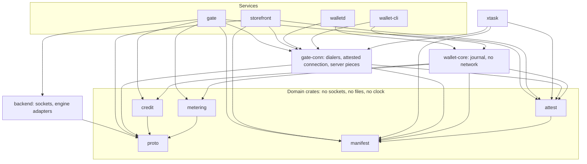

# 03. Code architecture

This document describes how the code would be organised, which layer may call which, and the small set of abstractions that carry the design. The signatures are sketches to show shape. [ARCHITECTURE.md section 8](../../ARCHITECTURE.md#8-code-architecture) is the authority, and where the two disagree, it wins. A local prototype of this workspace lives in `prototype/`, and [`prototype/SPEC.md`](../../prototype/SPEC.md) is the contract it's built against.

## 1. Repository layout

One Cargo workspace with one committed lock, so a conflict such as the `rusqlite` one shows up immediately.

```text
counteractive/
├── Cargo.toml              workspace, shared dependency versions
├── Cargo.lock              committed from the first commit
├── rust-toolchain.toml     1.92
├── deny.toml               licences, bans, sources, dated advisory exceptions
├── .cargo/config.toml      xtask alias
├── .github/workflows/      CI, double build, cargo tree bans, actions/attest
├── crates/
│   ├── proto/              wire types for gate, storefront and local APIs, OpenAI subset, bounded SSE splitter
│   ├── credit/             wraps act-rs: Moderator (gate) and Holder (wallet)
│   ├── manifest/           manifest and release.json types, canonical JSON, minisign check
│   ├── attest/             evidence bundle, ReportBinding with role, REPORT_DATA, SNP policy checks
│   ├── metering/           hold, debit, receipt arithmetic
│   ├── backend/            InferenceBackend trait and engine adapters
│   ├── gate-conn/          dialers (Unix, TCP, Arti), inner TLS client, UnverifiedConn, AttestedConn
│   ├── crash-point/        crash_point! macro for kill tests
│   ├── gate/               the CVM service: states, API, store, sessions, issuance socket
│   ├── storefront/         the CVM purchase service: orders API, Stripe client, issue.sock client
│   ├── wallet-core/        journal, chains, reconcile, no network
│   ├── wallet-cli/         purchase and issuance over the TCP dialer; drives walletd
│   ├── walletd/            local API and Tor, the wallet's only Arti
│   ├── fake-engine/        deterministic engine on a Unix socket for tests
│   └── fake-stripe/        the two Checkout Session endpoints plus a test pay call
├── xtask/                  build, measure, sign, deploy, unlock, export
├── image/                  mkosi config, units, firewall, torrc, boot scripts. Tree in 07 section 3.
├── deploy/                 Verda REST script, flash script, instance definitions
├── tests/
│   ├── e2e/                tier 1: no Tor, fake engine, fake Stripe, kill tests
│   ├── tor-smoke/          tier 2: C tor, Arti, TLS, unix target on the live network
│   ├── chutney/            tier 3: private Tor network for floods
│   └── vectors/            chat template goldens
└── docs/architecture/
```

`fake-stripe` exists so tests exercise the storefront's real HTTP client against a local server ([section 5.7](#57-payment-provider)).

## 2. Layering rules



These rules apply to every change.

1. **Domain crates do no IO.** `proto`, `credit`, `manifest` and `metering` take bytes and values and return values. They read no clock, so the caller passes `now`. Most of the money logic can therefore be tested deterministically.
2. **`attest` splits along feature flags.** Verification is pure and available everywhere, including macOS. The `guest` feature adds the `/dev/sev-guest` calls, and only the gate and the storefront enable it, the gate also for `gate snp-ids`, which the boot collector runs. The `measure` feature adds `sev::measurement` for `xtask`.
3. **Third-party crypto stays behind one crate.** Only `credit` names `act-rs` types. Only `attest` names `sev`. Replacing one means changing one crate. `sev` has already announced a parser break, so this isn't hypothetical.
4. **Services hold state and sockets, and little else.** Handlers parse, call a domain function, persist, and respond.
5. **Domain crates may not depend on service crates.** Cargo enforces this, because cycles don't compile.
6. **Secrets use `secrecy` types with no `Debug` output.** K, the issuer seed, issue and spend states, spend bytes, seal keys, the Stripe key and the storefront operator token must not reach a log. Spend bytes count, because they derive the seal key.
7. **Two network stacks in the wallet, never mixed**, and **the gate has no outbound client.** [Section 4](#4-the-two-stack-rule) states both.

## 3. Crate responsibilities

| Crate | Owns | Must not contain | Rough lines |
|---|---|---|---|
| `proto` | Gate, storefront and local API messages, OpenAI subset structs with allowlisted fields, finish reasons, SSE splitter with a byte limit | Any business rule | 500 |
| `credit` | `Moderator` and `Holder`, context derivation, `Params` for L=24, conversions to and from bytes | Storage, policy | 350 |
| `manifest` | Types, canonical JSON, signature check, `accept` rule including version monotonicity, `release.json` types including products | Network | 300 |
| `attest` | Evidence bundle, `ReportBinding` with role, policy checks, pinned AMD roots with a fingerprint test, `AttestationVerifier` | Network | 650 |
| `metering` | Hold, clamp, debit, receipt, checked arithmetic, `SessionLedger` | Clocks, async | 300 |
| `backend` | `InferenceBackend`, `vllm`, `llamacpp`, `fake`, HTTP helper over Unix sockets | Credits | 600 |
| `gate-conn` | Recording verifier, inner TLS client config, `Dialer`, `UnixDialer`, `TcpDialer` behind a `tcp` feature, `ArtiDialer` behind an `arti` feature, `UnverifiedConn`, `AttestedConn`. A `server` feature holds identity generation, the rustls acceptor config and a serve loop, shared by gate and storefront. | Wallet state, operator logic | 550 |
| `crash-point` | The `crash_point!` macro | Anything else | 30 |
| `gate` | API, TLS, slot table, money store, custody, boot state machine, issuance on `issue.sock`, `snp-ids` subcommand | `reqwest`, Arti, any outbound network code | 1,800 |
| `storefront` | Orders API, `PaymentProvider` over `reqwest`, `issue.sock` client, inner TLS with role `storefront`, operator configure | Credential keys, sessions, a database, Arti | 600 |
| `wallet-core` | Journal, chain state machine including purchase, reconcile, keychain, recount, compiled-in pins | Sockets, TLS | 1,400 |
| `wallet-cli` | Purchase and issuance on `AttestedConn` over the TCP dialer, browser launch, calls to `walletd` | Arti, `reqwest` | 500 |
| `walletd` | Session methods on `AttestedConn`, supervisor, local API, page | `reqwest`, the TCP dialer | 750 |
| `fake-engine` | Scripted streams, stalls, overruns, mid-stream death | Real tokenisers | 200 |
| `fake-stripe` | The two Checkout Session endpoints in memory, a pay page, `POST /test/pay/{id}` | Anything beyond what the storefront calls | 150 |
| `xtask` | Release pipeline, deploy wrapper, operator methods on `AttestedConn` for gate and storefront, probes | Runtime dependencies of any service | 750 |

These add up to about 9,400 lines of Rust, plus about 500 of image configuration and scripts. They're estimates to convey scale, not commitments.

### `xtask`

The only binary that talks to the gate or the storefront as an operator, and the only one allowed both network stacks, because it reaches Verda's API by HTTPS, the gate by Tor and the storefront over clearnet. It holds no user money.

```text
xtask/src/
├── main.rs
├── keys.rs          keygen: K, storefront operator token
├── image.rs         build: run mkosi twice, compare bytes
├── measure.rs       measure: sev-snp-measure and sev::measurement, compare
├── release.rs       generate release.json from image/release.template.json
├── manifest.rs      manifest: draft, sign prompt, verify
├── verda.rs         deploy, flash: calls deploy/ scripts
├── operator.rs      unlock, configure, drain, export, state, on AttestedConn
└── probe.rs         probe: external health check, alarm
```

| Command | Does |
|---|---|
| `keygen` | Generates K and the storefront operator token, offline |
| `build` | Double build and byte comparison |
| `measure` | Predicts the launch digest with both tools |
| `manifest` | Writes and verifies a manifest, including `--issuer-key`. Signing stays a manual minisign step. |
| `deploy`, `flash` | Creates an instance, writes the onion key to a local image copy, and flashes it |
| `unlock` | Attests the gate over Tor and sends K with a manifest. Then attests the storefront over clearnet, with role `storefront`, and sends the Stripe restricted key with the operator token. |
| `unlock --init` | First deployment: attests against the bootstrap manifest and sends K, which returns the issuer public key. A plain `unlock` configures the storefront once the gate is Ready. |
| `unlock --state [--replace]` | Attests, imports a store, unlocks, then configures the storefront. Reads `/v1/health` before a retry, and treats Ready as success. |
| `drain`, `export`, `state` | Update path |
| `probe` | Reaches the public health endpoint through Tor from outside |

## 4. The two-stack rule

The wallet has two network stacks that must never touch.

| Binary | Network library | DNS | Used for |
|---|---|---|---|
| `wallet-cli` | `gate-conn` with the `tcp` feature: `TcpDialer`, attested TLS | None: the storefront address is compiled in, with no domain | Storefront only |
| `walletd` | `arti-client` and `hyper`, through `gate-conn` with the `arti` feature | None: Tor resolves | Gate only |

`wallet-cli` has only the TCP dialer, and `walletd` has only the Arti dialer. `gate-conn` exposes them as separate features, and `wallet-core` depends on neither. A `cargo tree` check in CI fails if `arti-client` appears under `wallet-cli`, or the TCP dialer under `walletd`. It also fails if `reqwest` appears under either wallet binary or the gate, or `arti-client` under the gate or the storefront. `xtask` is allowed both stacks, since it never handles a wallet's money. The prototype's end-to-end run includes this check ([SPEC section 10](../../prototype/SPEC.md#10-end-to-end-acceptance), step 11).

`wallet-cli` never talks to the gate. When it needs something done on the use plane, such as a chat, a close or a reconcile, it asks `walletd` over localhost. So a bug in `wallet-cli` can't put a spend on a clearnet connection, because it has no code path to the gate. In the other direction, `walletd` has no code path to the storefront, so nothing at use time leaves from the user's real IP.

The service-side equivalent: `gate` has no outbound client at all. It listens on two Unix sockets: `gate.sock` for tor, with inner TLS, and `issue.sock` for the storefront, local, without TLS and restricted by group. Boot-time fetches happen in a separate unit before the gate starts, and the gate reads the results from files. The storefront alone uses `reqwest`, and only to reach Stripe. Its only route to the gate is `issue.sock`.

## 5. Key abstractions

### 5.1 Inference has two independent axes

**Engine axis: what runs the model.** Adding an engine means one adapter.

```rust
pub trait InferenceBackend: Send + Sync {
    /// Static facts. The gate compares these against the session policy
    /// and rejects a request rather than quietly downgrading it.
    fn describe(&self) -> BackendCapabilities;

    /// Prompt tokens for exactly the body `start` would send.
    async fn count_prompt(&self, req: &EngineRequest) -> Result<u32, BackendError>;

    /// Starts generation. Dropping the stream cancels upstream.
    async fn start(
        &self,
        req: EngineRequest,
        limit: OutputLimit,
    ) -> Result<EngineStream, BackendError>;

    async fn health(&self) -> Health;
}

pub struct BackendCapabilities {
    pub usage_source: UsageSource,  // EngineCounted | ProviderReported
    pub usage_trust: UsageTrust,    // InsideAttestedBoundary | Unsigned
    pub byte_sealing: ByteSealing,  // InnerTls | Ehbp
    pub token_ids: bool,
}

pub enum EngineEvent {
    Delta { text: String, tokens: u32 },
    Usage { prompt: u32, completion: u32 },
    Finish(FinishKind),   // Stop | Length | Abort | Error | Repetition
}
```

| Implementation | Status | Notes |
|---|---|---|
| `vllm` | PoC production | Unix socket, `return_token_ids`, forced usage |
| `llamacpp` | Laptop, nightly CI | Same socket style, no exact IDs while streaming. Differences are declared in `describe()`. |
| `fake` | CI | Scripted events and faults |
| `tinfoil-pooled` | Later | Provider-reported, unsigned usage. Needs a written agreement. |

**Platform axis: what proves the code is genuine.** The gate and the storefront produce evidence, and the wallet and `xtask` check it.

```rust
pub trait AttestationSource: Send + Sync {
    fn platform(&self) -> PlatformId;
    async fn evidence(&self, binding: &ReportBinding) -> Result<EvidenceBundle, AttestError>;
}

pub trait AttestationVerifier {
    fn verify(
        &self,
        bundle: &EvidenceBundle,
        binding: &ReportBinding,
        entry: &MeasurementSet,
        now: Timestamp,
    ) -> Result<Verdict, Rejection>;
}

pub struct ReportBinding {
    pub role: Role,                    // Gate | Storefront
    pub tls_spki_sha256: [u8; 32],
    pub gpu_evidence_sha256: [u8; 32],
    pub wallet_nonce: [u8; 32],
}
```

Gate and storefront run in one VM, so their reports carry the same measurement. The role in the binding is what tells them apart, so a storefront report can't stand in for the gate's, or the reverse. A verifier always states the role it expects. [inferred]

| Implementation | Status | Notes |
|---|---|---|
| `snp-verda` | PoC production | SEV-SNP report, stapled VCEK and CRL, GPU appraisal hash |
| `dev-insecure` | Laptop | No hardware. Prints a loud banner. A release build refuses it. |
| `tinfoil-container` | Later | Needs GPU access through Tinfoil |

The manifest names both axes, so a wallet knows which verifier and which usage trust apply, and shows that to the user. Platform is per release, and engine and usage trust are per model in that release's catalogue. Credit scheme is per service.

```json
{
  "service": { "credit_scheme": "ec-act-p256-v0" },
  "releases": [{
    "platform": "snp-verda",
    "release_config": { "catalogue": [{ "engine": "vllm", "usage_trust": "inside_attested_boundary" }] }
  }]
}
```

### 5.2 Credit interface

Different schemes have different failure and privacy behaviour. A generic `spend()` would hide that, so the interface stays concrete and each scheme publishes its properties.

```rust
// crates/credit: wraps act-rs. No IO.
pub struct Moderator { params: Params, key: SecretKey, ctx_cred: Vec<u8>, ctx_spend: Vec<u8> }

impl Moderator {
    pub fn from_seed(seed: &SecretSeed, service: &ServiceContext) -> Result<Self, CreditError>;
    pub fn public_key(&self) -> IssuerPublicKey;
    pub fn issue(&self, credits: u64, request: &[u8]) -> Result<Vec<u8>, CreditError>;

    /// Cheap. Runs before any expensive verification.
    pub fn peek_nullifier(&self, spend: &[u8]) -> Result<Nullifier, CreditError>;

    /// Verifies and returns the facts the gate needs. VerifiedSpend from
    /// act-rs borrows the message and can't be stored, so close verifies again.
    pub fn verify_spend(&self, spend: &[u8]) -> Result<SpendFacts, CreditError>;
    pub fn refund(&self, spend: &[u8], t: u64) -> Result<Vec<u8>, CreditError>;
}

// The wallet's side. Every state has a byte encoding, so it can be journalled first.
impl Holder {
    pub fn issue_request(&self) -> Result<(IssueState, Vec<u8>), CreditError>;
    pub fn finalize_issue(&self, state: IssueState, response: &[u8]) -> Result<Credential, CreditError>;
    pub fn prove_spend(&self, cred: Credential, s: u64) -> Result<(SpendState, Vec<u8>), CreditError>;
    pub fn finalize_refund(&self, state: SpendState, refund: &[u8]) -> Result<Credential, CreditError>;
}

pub struct SchemeDescriptor {
    pub id: &'static str,              // "ec-act-p256-v0"
    pub whole_chain_exposure: bool,    // true: losing a credential loses the chain
    pub verifier_holds_secret: bool,   // true: the gate needs the issuer secret
    pub serialised_chain: bool,        // true: one open spend per chain
    pub settlement: Settlement,        // Exact | Grid { q }
}
```

The allowance parameter `a` in `act-rs`'s `prove_spend` lets a refund exceed the spend. The PoC always sets `a = 0`, and `Moderator` rejects any other value, so a refund can never raise a balance.

A later scheme would add a sibling type and its own `SchemeDescriptor`. It would change the gate's session opening and the wallet's chain logic. It wouldn't change metering, TLS, attestation or the engine layer. That estimate is rough and a reason to keep the interface honest rather than abstract.

### 5.3 Key custody

```rust
pub trait KeyCustody: Send + Sync {
    /// Resolves once the key that opens the money store is available.
    async fn store_key(&self) -> Result<StoreKey, CustodyError>;
}
```

| Implementation | Status |
|---|---|
| `OperatorDelivered` | PoC. Waits for `/v1/operator/unlock`. |
| `SnpDerivedWrap` | Later. Adds unattended restart on one chip. |
| `EnclaveHandoff` | Later. Old enclave passes the key to a signed new image, which hides it from the operator. |

### 5.4 Attested connection

`gate-conn` holds everything `walletd`, `wallet-cli` and `xtask` need to reach the gate or the storefront. Its `Dialer` makes most tests free of Tor.

```rust
pub trait Dialer: Send + Sync {
    type Stream: AsyncRead + AsyncWrite + Send + Unpin;
    /// Scope maps to one isolated Arti client per conversation.
    async fn dial(&self, target: &Target, scope: &DialScope) -> Result<Self::Stream, DialError>;
}
```

`ArtiDialer`, behind the `arti` feature, reaches the gate in production. `TcpDialer`, behind the `tcp` feature, reaches the storefront. `UnixDialer` is for tier 1 tests. All three carry the same TLS, attestation and HTTP code above them.

### 5.5 A connection type that can't send secrets early

The order "attest first, then send secrets" is enforced by types rather than by convention.

```rust
pub struct UnverifiedConn { /* TLS done, SPKI recorded */ }
pub struct AttestedConn { /* only built by attest */ }

impl UnverifiedConn {
    /// Public and signed, so it's safe before attestation. The caller checks the signature.
    pub async fn fetch_manifest(&mut self) -> Result<SignedManifest, GateError>;

    pub async fn attest(self, verifier: &dyn AttestationVerifier, role: Role, /* ... */)
        -> Result<AttestedConn, Rejection>;
}

impl AttestedConn {
    /// Low-level. wallet-cli adds order and collect, walletd adds open_session
    /// and chat, and xtask adds the operator calls, each as its own extension trait.
    pub async fn request(&mut self, req: GateRequest) -> Result<GateResponse, GateError>;
}
```

`UnverifiedConn` has no method that accepts an order secret, issue request, spend, prompt, K, the operator token or the Stripe key.

A cached verdict can build an `AttestedConn` without a new report, only if the connection's recorded SPKI matches the verdict and it hasn't expired.

### 5.6 Money stores with crash points

```rust
pub trait MoneyStore: Send {
    fn spend_status(&self, n: &Nullifier) -> Result<SpendStatus, StoreError>;
    fn insert_pending(&mut self, n: &Nullifier) -> Result<InsertOutcome, StoreError>;
    /// Compare-and-set: only a Pending row is settled, and a missing row is inserted
    /// settled. On Lost, the caller unseals the winner's row with its own bytes.
    fn settle(&mut self, n: &Nullifier, sealed_refund: &[u8]) -> Result<SettleOutcome, StoreError>;
    /// Keyed by order_ref. An existing row with the same request hash returns its
    /// stored response, and one with a different hash is a conflict.
    fn record_issue(&mut self, order_ref: &OrderRef, request_hash: &[u8; 32], response: &[u8])
        -> Result<IssueOutcome, StoreError>;
}

pub enum SettleOutcome { Won, Lost { sealed_refund: Vec<u8> } }
pub enum IssueOutcome { Recorded, Existing { response: Vec<u8> }, Conflict }
```

A `crash_point!("after_insert_pending")` macro, from the `crash-point` crate, aborts the process when a test build has that point armed through an environment variable. It compiles to nothing otherwise. Kill tests iterate over every named point on both sides of every durable transition, then check the invariants in [05](05-component-gate.md#9-invariants) and [04](04-component-wallet.md#9-invariants). Crash points don't exercise races, so the gate's slot interleavings have their own tier 1 tests ([05 section 5](05-component-gate.md#session-slots)).

### 5.7 Payment provider

The storefront's one outbound axis.

```rust
// storefront: Stripe in production, fake-stripe in tests, same HTTP code.
pub trait PaymentProvider: Send + Sync {
    async fn create_checkout(&self, product: &Product, reference: &str) -> Result<Checkout, PayError>;
    async fn get_checkout(&self, id: &str) -> Result<CheckoutStatus, PayError>;
}
```

There is one implementation, over `reqwest`, with a configurable base URL: `https://api.stripe.com`, or a local `fake-stripe`. So tier 1 tests run the storefront's real HTTP client, and only the server on the other end differs. The calls themselves are in [06 section 3](06-component-storefront.md#3-payment).

## 6. Test tiers

| Tier | What runs | Network | Frequency | Proves |
|---|---|---|---|---|
| Unit | Domain crates | None | Every commit | Arithmetic, parsing, vectors, policy checks |
| 1. Integration | Gate, `walletd`, `wallet-cli`, storefront, fake engine and `fake-stripe` as plain processes | Unix sockets through `UnixDialer`, TCP to the storefront through `TcpDialer`, real inner TLS | Every commit | Money loop, purchase and issuance, kill tests, idempotency, hostile inputs |
| 1b. Real engine | Tier 1 with `llama-server` | Unix sockets | Nightly | Metering against a real model |
| 1c. Stripe sandbox | Tier 1 with the storefront pointed at Stripe's sandbox and a test card | HTTPS to Stripe | On demand | Real Checkout Session shapes. Not yet run: it needs a sandbox key. |
| 2. Live smoke | C tor, embedded Arti, hyper, TLS, `unix:` target | Live Tor | Nightly, plus before each release | This pairing has never run. **It's the first Tor test, and its failure rate is a measurement we don't have.** |
| 3. Chutney | 4 authorities, 6 relays, C tor service, Arti client | Private, in a Linux VM | On demand | Floods, stream limits, Sandbox and PoW interaction. 2 to 3 days to set up. |
| 4. Verda | Real image on a real CC instance | Live | Per release | Measurement, GPU, end to end |

Fixtures: `apply_chat_template` goldens, and a wrong-everything suite for `attest` (wrong key, wrong nonce, wrong role, wrong measurement, wrong TCB, debug policy, expired, wrong chip).

## 7. Change recipes

These show how the structure is meant to absorb change.

**Add a model on the same engine.**

1. Add an entry to `image/release.template.json`: ID, commit, price, limits.
2. Build a pack with `modelwrap`, and add a verity partition and mount.
3. Add one engine unit with its own socket.
4. Release as usual. No code changes unless the template needs special handling.

**Add an inference engine.**

1. Add a module in `backend` implementing `InferenceBackend`.
2. Declare `describe()` honestly.
3. Add it to the fake-engine conformance tests.
4. Add a unit file and name it in the manifest.

**Add Tinfoil Containers as a platform.**

1. Add a `tinfoil-container` `AttestationSource` and matching verifier.
2. Add a manifest entry naming the platform and measurement set.
3. Run the same gate in their container, once GPU access is arranged.

Wallets need the verifier in a release before they'll use the entry. Older wallets skip the unknown platform. This covers the code. What it means for tor, the store, K and evidence is in [08 section 9](08-decisions-and-validation.md#9-tinfoil-containers-as-a-target), and it hasn't been tried.

**Add the Tinfoil pooled API as an engine.** Implement `InferenceBackend` with `usage_trust: Unsigned` and `byte_sealing: Ehbp`. The wallet must display that usage is provider-reported, and the session policy decides whether to accept it. This needs a written agreement with Tinfoil. Its token counts aren't attested.

**Replace EC-ACT.** Add a scheme type beside `Moderator` and `Holder`, a `SchemeDescriptor`, and new journal states. Session opening and refund change. Metering doesn't. See [08 section 2](08-decisions-and-validation.md#2-fallback-if-ec-act-fails-review).

**Move credit into its own CVM.** The credit calls in `gate/issue.rs` and `gate/sessions/` go through a client, and the moved code runs in a small CPU CC instance. The gate gets a second attested connection. This is a real change, which is why it's deferred, but `credit` and the store move unchanged.

**Add constant-size frames.** Add a `FramingPolicy` slot in the gate's SSE writer and `walletd`'s reader. It's a no-op in the PoC. Measure before enabling.

## 8. Conventions

- Errors: `thiserror` in libraries, typed enums at API edges. Public error bodies use a closed set of codes with no free text from internals.
- Logging: `tracing`, never with request bodies, and never `Debug` on secret types. Gate logs go to volatile journald. A CI test scans gate log output from an end-to-end run for a planted prompt string.
- Integers: credits are `u64`, always with checked arithmetic. No floats in money paths.
- Time: passed in, not read, in domain crates. The gate's session timers use a monotonic clock, not host wall time.
- API version: `/v1/` in paths, and a `schema` field in the manifest. A wallet refuses unknown schemas.
