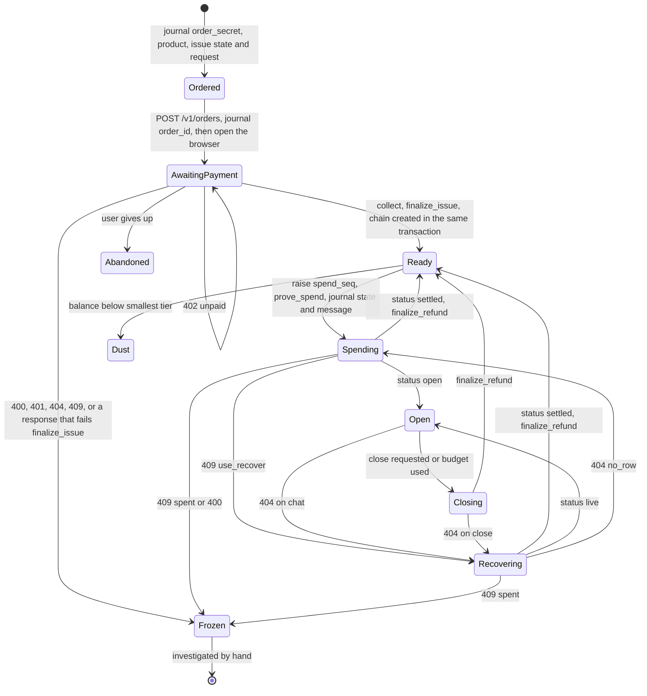

# 04. Component: wallet

The wallet buys credit, holds it, spends it over Tor, and shows and reconciles the balance. It's three crates: a library with no network code and two binaries that each own one network stack. The attested connection code it shares with `xtask` lives in [`gate-conn`](03-code-architecture.md#54-attested-connection). [ARCHITECTURE.md section 11](../../ARCHITECTURE.md#11-wallet) is the authority, and where the two disagree, it wins.

## 1. Process model

| Process | Lifetime | Network | User touches it through |
|---|---|---|---|
| `wallet-cli` | One command | Clearnet TCP to the storefront, with attested TLS, and localhost to `walletd` | Terminal |
| `walletd` | Long-running, supervised | Tor to the gate, and localhost for clients | Page, any OpenAI client, `wallet-cli` |

Both open the same SQLCipher journal through `wallet-core`, using SQLite's WAL mode, so they must keep to these writing rules:

| Table | Written by |
|---|---|
| `purchase`, and the `chain` row that collect creates in `Ready` | `wallet-cli` |
| `chain` from then on, `receipt`, `settled_session` | `walletd` |
| `manifest` | Either, through `manifest_store`'s accept rule in one transaction: `wallet-cli` with a manifest fetched from the storefront during a purchase, `walletd` with one fetched over Tor |

Arti can call `exit(1)` if a consensus shows it lacks a required protocol. Running it in a separate supervised process means that kills `walletd`, not the terminal. The supervisor restarts it once, then reports "this wallet version may need an update". Because every money step is journalled first, a dead process loses nothing. [read for Arti, inferred for the rest]

**Compiled into each wallet release**, because a manifest can't be allowed to choose them: `service_id`, the allowed `key_epoch` values, the onion address, the storefront address, the minisign public key, the session tier ladder and AMD's root fingerprints.

## 2. Directory structure

```text
crates/wallet-core/src/
├── lib.rs
├── pins.rs              values compiled into the release
├── journal/
│   ├── mod.rs           open, migrate, pragmas, one transaction helper
│   ├── schema.sql
│   ├── purchase.rs      orders and their issuance state
│   ├── chain.rs         credential chain states
│   └── receipts.rs      receipts and settled sessions
├── keys.rs              keyring first, passphrase fallback
├── chain.rs             choose chain, prepare spend, apply refund
├── reconcile.rs         exact check, classification, balance view
├── recount.rs           diagnostic local token count, behind a feature
├── policy.rs            session sizing from the tier ladder
└── manifest_store.rs    accepted and pending manifests, accept rule

crates/wallet-cli/src/
├── main.rs              clap
├── storefront.rs        orders and collect on AttestedConn over the TCP dialer
├── buy.rs               order, browser, collect, finalize_issue
├── daemon_client.rs     localhost calls to walletd
└── browser.rs           open the system browser

crates/walletd/src/
├── main.rs
├── supervisor.rs        Arti exit handling
├── gate_client.rs       open, chat, close and recover over AttestedConn, SSE reader, timeouts
├── conversation.rs      conversation to client and session mapping
├── session.rs           open, turn, close, recover, per-state gate responses
├── local_api/
│   ├── mod.rs           axum router, Host check, bearer token
│   ├── openai.rs        /v1/models, /v1/chat/completions
│   └── wallet.rs        /wallet/balance, /wallet/close, /wallet/reconcile, /wallet/manifest
└── page/index.html      embedded with include_str!
```

## 3. Commands and local API

| `wallet-cli` command | What it does |
|---|---|
| `init` | Creates the journal and its key |
| `buy --product <id>` | Journals a new order, creates it at the storefront, opens Checkout in the browser, then collects as below. One chain per purchase. |
| `collect` | For each order awaiting payment, asks the storefront to collect. Once paid, finalises issuance and journals a Ready chain. `--wait` keeps polling. |
| `balance` | Prints the balance view |
| `reconcile` | Runs the checks and prints discrepancies |
| `models`, `chat`, `close` | Convenience over `walletd` |
| `manifest fetch` | Fetches the manifest from the storefront, as part of a purchase, shows what changed, and asks for approval. Until then it stays pending. |
| `manifest update` | Asks `walletd` to fetch the latest manifest over Tor, shows what changed, and asks for approval |
| `doctor` | Checks versions, keychain, `walletd`, and whether the current manifest is expiring |

| `walletd` endpoint | Purpose |
|---|---|
| `GET /` | Embedded page |
| `GET /paid` | Static page that Checkout returns to after payment. It only says to return to the wallet. No token needed. |
| `GET /v1/models` | Catalogue from the accepted manifest |
| `POST /v1/chat/completions` | OpenAI-compatible, with streaming |
| `GET /wallet/balance` | Balance view |
| `POST /wallet/close` | Close a conversation's session |
| `POST /wallet/reconcile` | Recover unsettled sessions, then run checks |
| `GET /wallet/manifest` | Accepted and pending versions, and what differs |
| `POST /wallet/manifest` | Fetch a manifest over Tor, or approve a pending one |

Browsers can reach localhost, so `walletd` checks the `Host` header and requires a random bearer token stored in a file readable only by the user. The page gets it from an HTML response only when requested at the right host. The page uses a strict CSP, has no CDN, and inserts model text with `textContent`, so a model reply can't load a remote image or run a script. **No remote content is ever fetched because of model output.**

**The model selector** is a `GET /v1/models` call that fills a dropdown. **Balance** comes from `/wallet/balance`. Any other OpenAI client works against `/v1`, without the balance display.

**Conversation mapping.** An OpenAI request carries no conversation ID. `walletd` accepts an optional `X-Conversation-Id` header, which the page sends. Without it, each request is treated as its own conversation with its own circuit and session. That's slower (a fresh circuit's first byte had a median of 4.33 s in the earlier test) but it's the safe default, because nothing in the protocol links two requests. The exceptions are the connection-level signals in [limit 17](01-system-and-data-flow.md#accepted-limits) and the low-balance tiers in [section 7](#7-sessions-and-balance).

## 4. Journal

SQLCipher with `journal_mode=WAL` and `synchronous=FULL`. A raw random key is held in the OS keychain through `keyring`. If no keychain exists, it prompts for a passphrase. The first milestone may use plain `bundled` SQLite with test money only. [read, not run]

```sql
CREATE TABLE manifest (
  status TEXT PRIMARY KEY,           -- 'accepted' or 'pending'
  version INTEGER NOT NULL,          -- accepted version never decreases
  body BLOB NOT NULL, signature BLOB NOT NULL
);

CREATE TABLE purchase (
  purchase_id INTEGER PRIMARY KEY,   -- local; the row exists before the order does
  order_id TEXT UNIQUE,              -- the Checkout Session ID, set in AwaitingPayment
  order_secret BLOB NOT NULL,        -- never logged
  product TEXT NOT NULL,             -- product ID from the accepted release
  credits INTEGER NOT NULL,          -- that product's credits
  issue_state BLOB,                  -- never logged; cleared when collect commits
  issue_request BLOB,                -- sent unchanged on every retry; cleared when collect commits
  state TEXT NOT NULL,               -- Ordered, AwaitingPayment, Collected, Frozen or Abandoned
  chain_id INTEGER                   -- set in the collect transaction
);

CREATE TABLE chain (
  chain_id INTEGER PRIMARY KEY,
  state TEXT NOT NULL,
  credential BLOB,                   -- set in Ready and Dust
  spend_seq INTEGER NOT NULL DEFAULT 0, -- raised in the prove_spend transaction
  spend_state BLOB,                  -- set from Spending on
  spend_message BLOB,
  session_id BLOB,
  budget INTEGER,                    -- s of the current spend
  unknown_turns INTEGER NOT NULL DEFAULT 0 -- turns whose stream died before a receipt
);

CREATE TABLE receipt (
  chain_id INTEGER NOT NULL,
  spend_seq INTEGER NOT NULL,
  turn INTEGER NOT NULL,
  model TEXT NOT NULL,
  prompt_tokens INTEGER NOT NULL,
  completion_tokens INTEGER NOT NULL,
  charge INTEGER NOT NULL,
  remaining INTEGER NOT NULL,
  finish TEXT NOT NULL,
  PRIMARY KEY (chain_id, spend_seq, turn)
);

CREATE TABLE settled_session (
  chain_id INTEGER NOT NULL,
  spend_seq INTEGER NOT NULL,
  s INTEGER NOT NULL,
  t INTEGER NOT NULL,                -- from RefundMessage::return_amount()
  receipts_sum INTEGER NOT NULL,
  outcome TEXT NOT NULL,             -- see section 10
  PRIMARY KEY (chain_id, spend_seq)
);
```

Conversation text isn't in this schema. Saving history is a separate choice the page can make locally, and the PoC keeps it in memory. Receipts and settled sessions are a local usage record, so they're sensitive too.

The journal is sensitive financial material. A copy of it restored from backup can resurrect a spent credential state, which the gate would reject as a double spend. The chain would then be lost. Backups need care, and the PoC doesn't offer them.

## 5. State machine

Purchase, issuance and spending are one machine. States up to the first `Ready` live in `purchase.state`, and from `Ready` on in `chain.state`.



**Buying.** `wallet-cli` needs an accepted manifest first, for the product list and the storefront's measurement. It generates the order secret and calls `issue_request`, then journals the secret, product, credits, issue state and issue request in one transaction, as `Ordered`. Only then does it send `POST /v1/orders {product, secret_hash}` with `secret_hash = SHA-256(order_secret)`. It journals the returned `order_id` as `AwaitingPayment` before printing the Checkout URL or opening the browser. A crash in `Ordered` resends the order. The Checkout URL in a lost response never reached the user, so that session is never paid.

**Collecting.** `POST /v1/orders/{id}/collect {order_secret, issue_request}` returns `402 unpaid` until Stripe reports the session paid. Once it returns `{issue_response, credits}`, one transaction stores `finalize_issue`'s credential as a new `Ready` chain, sets the purchase to `Collected` with its `chain_id`, and clears the issue state and request. If `finalize_issue` fails, the purchase goes `Frozen` and the wallet reports a storefront or gate fault. A bad response never silently counts as credit.

A lost response or a `503` keeps the current state, and the wallet resends the same bytes. So a lost collect response means resending the same `issue_request`, and the gate returns its stored response. A lost open response means resending to `POST /v1/sessions`, not calling recover. If the gate has since closed the session, it answers `409 use_recover`.

Rules from `act-rs`'s own documentation apply here. [read]

- The issue request and state are generated once, journalled before the first send, and never regenerated, so a retry always sends identical bytes. `finalize_issue` consumes the state, so its result, the state deletion and the new chain commit in one transaction.
- `prove_spend` consumes the credential, and its state must be stored before the message leaves. So the journal transaction replaces `credential` with `spend_state` and `spend_message`. Only then does the send happen.
- A second proof from the same credential would reveal the same nullifier, so a retry always resends the stored `spend_message` bytes and never re-proves.
- `finalize_refund` consumes the state. Its result, the state deletion and the `settled_session` row commit in one transaction.

**What this exposes.** This is whole-chain exposure: if a journal is lost during a session, the entire remaining balance of that chain is gone, not just the session's budget. One chain per purchase bounds this at the purchase size, $5 in the PoC. The wallet can split risk only by making more, smaller purchases.

A valid proof can't be rejected outright, because the gate settles an out-of-policy spend with a full refund ([05 section 5](05-component-gate.md#opening-a-session)). That protects a chain when a release lowers `maximum_spend` while a proof is journalled.

## 6. Attestation check

`attest` implements this, and the wallet calls it through `gate-conn`, for the gate over Tor and for the storefront over clearnet. All of it runs offline against the stapled evidence. The wallet never contacts AMD or NVIDIA.

| Check | Rejects when | Source of the expected value |
|---|---|---|
| Chain | ARK or ASK doesn't match pinned fingerprints; VCEK not signed by ASK; report signature invalid | Compiled in, `1f084161…` and `5b77ef5f…`, with a test that fails if a crate bump changes them |
| Dates | VCEK outside validity | Local clock |
| CRL | VCEK revoked; CRL not signed by ARK; older than policy | Stapled. Enforced from M7. |
| VCEK against report | TCB or chip ID differ | Report |
| Policy | Debug enabled, or policy differs from the recorded value | Manifest. Exact value comes from the first real report. |
| VMPL | Not 0 | Fixed |
| TCB | Committed differs from current; below floor | Manifest. See the AMD limit below. |
| Measurement | Not in the manifest's list; entry past `not_after` | Signed manifest |
| Binding | `REPORT_DATA` differs from the recomputed hash | The role this connection expects (`gate` or `storefront`), wallet's nonce, recorded SPKI, hash of supplied GPU evidence |

Gate and storefront run in one VM and share a measurement, so the role in the binding is what stops a storefront report standing in for the gate's ([03 section 5.1](03-code-architecture.md#51-inference-has-two-independent-axes)).

**AMD's TCB gap.** AMD withdrew its published values on 24 September 2026, so the floor initially records what a real report shows, and the wallet labels the service "experimental" in the UI. The label stays until a supported floor exists.

**GPU.** The wallet doesn't appraise the GPU. The measured guest ran `nvattest` at boot and refuses to start the gate otherwise, so the attested measurement implies the appraisal passed. The wallet checks only that the evidence hash matches the one bound in the report. The evidence is included so an auditor can re-appraise it.

**TLS details.** TLS 1.3 only, `Resumption::disabled()`, `enable_sni = false`, ALPN `http/1.1`, one fixed dummy server name per role. Resumption is off so two conversations can't be linked at the gate by session tickets. [source read for all of these settings]

**Verdict cache.** A verdict is reused for about an hour, only when the service and SPKI match and the verdict hasn't expired. A connection that skips attestation shows the gate that this wallet attested recently, which is a weak marker that mostly matters at low traffic ([limit 17](01-system-and-data-flow.md#accepted-limits)). Attesting on every connection would remove it, at the cost of one report and one evidence transfer per default request. M6 measures the report rate, and that decides it.

**Manifest acceptance** (`manifest::accept`). A manifest is accepted only if:

- its signature is valid under the compiled-in key, and its schema is known;
- `version` isn't below the highest accepted;
- `service.id`, `service.onion` and `service.key_epoch` equal the compiled-in values;
- `credit_scheme` is known, and `issuer_public_key` is present;
- at least one release has a known platform. Unknown platforms are skipped, so adding one doesn't break older wallets.

Contexts are derived from the compiled-in values, using the formula in [07 section 7](07-enclave-image-and-deployment.md#manifest). Comparing them with a value in the same signed file wouldn't stop a hostile signer, so only compiled-in values prevent per-user contexts. The tier ladder and the storefront address are compiled in for the same reason. A key epoch change voids all chains and needs a new wallet release.

**Fetched isn't accepted.** A fetched manifest, from the storefront or over Tor, goes to `pending`. The user approves it after seeing the version and image changes. That includes a new wallet's first manifest, which has nothing to compare against. This pinning policy avoids treating "latest signed" as safe. An approval step can't protect a user who approves everything, and one signer can still give one wallet a private manifest and release. [Limit 5](01-system-and-data-flow.md#accepted-limits) states this.

**Where a manifest may come from.** During a purchase, `wallet-cli` may fetch it from the storefront, because that moment is already identified. At use time it comes only over Tor: when a report's measurement isn't in the accepted manifest, `walletd` fetches `GET /v1/manifest` over Tor before sending any secret, then tells the user an approval is needed. An update check on the purchase plane at use time would be a use-linked request from the user's real IP, at a time the operator controls.

## 7. Sessions and balance

**Sizing.** The compiled-in ladder has placeholder tiers of 500,000, 50,000 and 5,000 credits. `s` is the largest tier not above `min(chain balance, maximum_spend of the attested release)`. Spending `s` reveals `s` to the gate, so most sessions show the same value, and the balance is almost never spent whole. Spending the whole balance would be a problem: the new balance would equal the last refund `t`, so the next `s` would repeat the previous `t` exactly and link the sessions. A descending ladder still shows the gate that this chain is nearly empty, and that's accepted. A chain below the smallest tier is `Dust`: at most $0.005 stranded, shown but not spendable.

**Choosing a chain.** Pick the first Ready chain. Concurrent conversations use different chains, so someone with one purchase can run only one session at a time. If none is free, the request gets a clear error.

**Exhaustion.** Each case has its own response, and a request rolls over at most once, so this can't loop.

| Gate says | Wallet does |
|---|---|
| `402 session_exhausted` | Close, finalise the refund, and open one new session if a tier fits. It uses a fresh TLS connection, so the gate has no connection-level link between them. Prompt history in the next request is still linkable by content inside the enclave. |
| `402 prompt_exceeds_budget {required}` | Close, finalise, and retry on any chain whose tier is at least `required`. If none, tell the user the prompt is too large for the remaining balance. |
| `400 zero_output` | Return the error to the client |

**Timeouts.** First-byte timeout with retry on a new circuit, per the Arti failure rates seen earlier. A retry after a failed open resends the same spend bytes. The content link is visible only inside the enclave, but an attacker who kills a stream can observe the retry from outside ([limit 17](01-system-and-data-flow.md#accepted-limits)).

**Balance view.**

```json
{
  "total_credits": 4998980,
  "total_usd": "4.998980",
  "estimated_tokens_remaining": {
    "qwen3-0.6b": {"output_tokens_at_most": 1666326}
  },
  "chains": [{"id": 1, "state": "Ready", "credits": 4998980, "resolved": true}],
  "orders_awaiting_payment": [{"product": "usd-5", "credits": 5000000}],
  "frozen_orders": 0,
  "frozen_chains": 0,
  "dust_credits": 0,
  "experimental_platform": true,
  "manifest_version": 7
}
```

The token estimate divides credits by the model's output rate from the accepted release. It's an upper bound labelled as an estimate, since input tokens also cost. Credits remain the exact unit.

| State | Contribution to total |
|---|---|
| Ready | `credential.balance()` |
| Open | `spend_state.remainder()` plus the last receipt's `remaining`, or plus `s` if no receipt yet |
| Spending, Closing, Recovering | The same formula, labelled unresolved |
| Ordered, AwaitingPayment | Shown separately with the product's credits, not in the total |
| Dust | Shown separately, not in the total |
| Frozen | Shown separately, not in the total |

An order isn't credit until collect returns. It may never be paid, so it stays out of the total.

## 8. Failure handling

This table is the single source for what the wallet does with each gate and storefront response, and kill tests assert against it.

| Failure or response | Detected by | Response | Money effect |
|---|---|---|---|
| Crash before `POST /v1/orders` returns | Journal in `Ordered` | Resend the order with the same secret hash | None |
| `402 unpaid` on collect | Response | Stay in `AwaitingPayment` and poll again later | None |
| Collect response lost | Timeout | Resend the same `issue_request`. The gate returns its stored response. | None |
| `409 order_issued` on collect | Response | `Frozen`. Keep everything and report. | One paid order unavailable until investigated. Should occur only after a restored journal or a bug. |
| `409 amount_mismatch` on collect | Response | `Frozen`. Keep everything and report. | One paid order unavailable until investigated. Expected only if a release changed or removed that product after the order. [inferred] |
| `400` on collect | Response | `Frozen`. Keep everything and report. | One paid order unavailable until investigated. Should occur only after a bug, since the request bytes never change. |
| `401` or `404` on collect | Response | `Frozen`. Keep everything and report. | One order unavailable until investigated. Should occur only after a bug. |
| Issue response fails `finalize_issue` | `finalize_issue` error | `Frozen`. Keep everything and report. | One paid order unavailable until investigated |
| Crash before `POST /v1/sessions` | Journal in `Spending` | Resend stored bytes | None |
| Open response lost | Timeout | Resend stored bytes. The gate returns the same live session, or `409 use_recover`. | None |
| `429` from the storefront; `503 retry`, `503 draining`, `503 locked`, `503 exported`, `503 low_disk`, `503 unconfigured` | Response | Keep the state and retry later with the same bytes | None |
| `409 use_recover` | Response | Move to `Recovering`, call recover | None |
| `status: settled` on open | Response | `finalize_refund`, back to `Ready` | None |
| `409 spent`, or `400` on a journalled proof | Response | `Frozen`. Keep everything and report. | Chain unavailable until investigated. Should occur only after a restored journal or a bug. |
| `402 session_exhausted`, `402 prompt_exceeds_budget` | Response | [Section 7](#7-sessions-and-balance) | None |
| `409 closing` on chat | Response | The gate is ending the session. Move to `Closing`, retry close, and treat this request as an exhausted one. | None |
| `409 turn_active` on chat | Response | An earlier turn hasn't ended, usually after a lost stream. Wait and retry. | None |
| `400 model`, `400 zero_output` | Response | Return the error to the client. The session stays open. | None |
| Stream lost mid-turn | No `done` event | Raise `unknown_turns`, reconnect, continue. Don't rerun. Final state comes from close. | Generated tokens and input were charged |
| Close response lost | Timeout | Retry close, which either returns the refund or gets `404`, then recover | None |
| Gate restarted, session gone | `404` on chat | `recover`, which refunds in full if the gate crashed | User is refunded |
| Recover returns `live` | Response | Back to `Open` | None |
| Recover returns `404 no_row` | Response | Back to `Spending`, resend. This also covers a host rollback, where the chain keeps its value. | None |
| Refund fails to verify | `finalize_refund` error | `Frozen`. Keep the state and report. Don't discard. | Chain unavailable until investigated |
| Receipts don't match `s − t` | Reconcile | See [section 10](#10-reconciling). The credential is still authoritative. | Depends on the case |
| Attestation fails | `Rejection` | Close the connection, send nothing, tell the user why | None |
| Measurement not in accepted manifest | `attest` | During a purchase, fetch from the storefront; at use time, fetch over Tor. Either way, ask for approval. | None |
| Manifest expired | `manifest::accept` | Fetch as above and ask for approval | None |
| Arti exits | Supervisor | Restart once, then advise an update | None |
| Keychain missing | `NoDefaultStore` | Passphrase prompt | None |

## 9. Invariants

Kill tests check these at every crash point.

1. Nothing secret goes to the gate or the storefront over an unattested connection.
2. `spend_message` and `spend_state` are durable before the first send.
3. One credential produces exactly one proof, and retries reuse its bytes.
4. The issue state and request are durable before the order is created, are never regenerated, and the state is never logged.
5. A paid order becomes credit only in the transaction that stores `finalize_issue`'s credential.
6. `wallet-cli` has no route to the gate and `walletd` no route to the storefront.
7. The balance shown follows the table in section 7, and a credential's balance comes only from `finalize_issue` or `finalize_refund`.
8. No network request results from model output.
9. A manifest is fetched from the storefront only during a purchase, and otherwise only over Tor. A fetched manifest is never accepted without the user's approval.
10. A retried request never rolls over to a new session more than once.

## 10. Reconciling

The credential balance is authoritative, because `finalize_refund` verifies a signature over `t`, and the proof system enforces `new balance = old − s + t`.

**Exact check.** Each settled session is classified in the `finalize_refund` transaction, and `settled_session` keeps the result, so `reconcile` can show it later. `t` comes from the refund message itself, using only what the wallet holds.

| Case | Outcome | Reported as |
|---|---|---|
| `receipts_sum == s − t` | `exact` | Nothing to report |
| `t == s` with receipts present | `full_refund` | "Refunded in full", as in a gate crash. Not a mismatch: the user was undercharged. |
| `receipts_sum < s − t` with `unknown_turns > 0` | `receipt_gap` | "Charged, receipt not received", with the amount |
| Any other difference | `mismatch` | Loudly, with both numbers. A possible overcharge when `receipts_sum` is smaller. |

Inside attested TLS, receipts are unsigned. A signature on them would become useful only for disputes with a third party, and the PoC has none.

**Local recount, a diagnostic only.** `tokenizers` plus `minijinja` can recount locally. The earlier test measured 242 of 434 text recounts mismatching, about 1.5% low overall, so this can't detect small overcharging and has no fraud threshold. It can show gross inflation, such as splitting per character. It's the first thing to drop if golden template tests are awkward, and it would run only on request, so ordinary use never loads it.

## 11. Open questions for this component

- `keyring` behaviour on the actual targets, and passphrase UX on headless Linux. [unknown]
- `bundled-sqlcipher-vendored-openssl` build time and portability. [unknown]
- Whether the embedded page is worth keeping once `chat` exists. If nobody uses it, drop it. A model selector and balance display are in your requirements, so the CLI must then show both.
- A desktop app isn't in the PoC.
