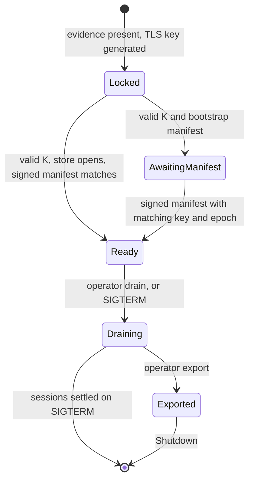

# 05. Component: gate

The gate is the small service inside the confidential VM that everything passes through. It's the only code of ours that sees prompts, and the only code holding the issuer key at runtime. It should stay small enough for one person to read in a sitting. [ARCHITECTURE.md section 9](../../ARCHITECTURE.md#9-gate) is the authority, and where the two disagree, it wins.

## 1. Directory structure

```text
crates/gate/src/
├── main.rs              startup, signal handling, state machine driver, snp-ids subcommand
├── state.rs             Locked, AwaitingManifest, Ready, Draining, Exported
├── config.rs            read and check /etc/gate/release.json, including products
├── tls.rs               per-boot key, rcgen certificate, TlsAcceptor config
├── serve.rs             UnixListener loops: gate.sock with TLS, issue.sock without; hyper http1, limits
├── custody.rs           KeyCustody, OperatorDelivered
├── seal.rs              HKDF and AEAD for stored results
├── attestation.rs       evidence files, SNP report behind a semaphore
├── store/
│   ├── mod.rs           MoneyStore trait
│   ├── sqlcipher.rs     rusqlite implementation, pragmas, copy, import
│   └── schema.sql
├── issue.rs             issuance by order_ref: lookup, product check, issue_response, record
├── sessions/
│   ├── mod.rs           slot table, timers
│   ├── open.rs          order of checks in POST /v1/sessions
│   ├── chat.rs          hold, clamp, stream, debit, receipt
│   ├── close.rs         refund and settle
│   └── recover.rs       settled, live, or crashed
├── api/
│   ├── public.rs        health, manifest, attestation
│   ├── local.rs         POST /local/issue on issue.sock
│   ├── sessions.rs
│   └── operator.rs      unlock, manifest, import, drain, export, state
└── models.rs            catalogue to backend map
```

`backend/` holds the engine adapters and `metering/` the arithmetic, so neither is here.

## 2. Boot state machine



| State | Serves | Everything else returns |
|---|---|---|
| Locked | Health, attestation, manifest if one is stored, unlock, import | `503 locked` |
| AwaitingManifest | Health, attestation, unlock (idempotent, returns the stored public key), operator manifest | `503 locked` |
| Ready | Everything except unlock and import | |
| Draining | As Ready, except that new sessions return `503 draining` and issuance returns `503 locked`. Live sessions continue until the drain deadline, then the gate closes them. Recover still works. Export becomes available once no session is live. | |
| Exported | Health, attestation, manifest reads, and a repeat of export | `503 exported` |

`503 locked` matters because a wallet must never read an unserved route as "no such row". `issue.sock` serves issuance only in Ready. In every other state it returns `503 locked`, which the storefront passes to the wallet, and a paid order stays collectable until the gate is Ready again.

**Entering AwaitingManifest.** With a valid K and a verified bootstrap manifest:

- With no store, the gate creates one, generates the seed, records `key_epoch` from the manifest, commits and returns the public key.
- With a store and no full manifest recorded, it returns the existing key. This covers a lost response or a gate crash during first deployment.
- With a full manifest recorded, it refuses, so nobody can step back from Ready.

**Entering Exported.** The gate takes the store lock, marks itself Exported, waits for in-flight transactions, and only then copies the store. Every store write checks this mark under the same lock, so nothing can commit after the copy, even from a request already past its first checks. Without this, a crashed session could be refunded once on the old store and once on the new one. Leaving Exported is only through Shutdown.

**A gate process restart is a fresh start.** After a crash, systemd restarts the gate, which comes back Locked with a new TLS key and no sessions. It needs another unlock.

K is 32 random bytes, generated by the operator. `release.json` pins `SHA-256(K)`, so nobody else can win the race to initialise a fresh store. The gate is unprivileged and has no shell, no SSH and no `cryptsetup`. It receives K from one attested operator connection, for one purpose.

**What K does and doesn't give the operator.** See [section 4](#4-money-store) for the precise statement. In short, K can mint credit and shows store metadata, and doesn't give access to prompts or the TLS key. This must be reconciled with `tee_gpu_attestation.md` L109, which argued that operator unlock flows contradict the promise. The difference: that note concerned a passphrase unlocking a whole root filesystem through SSH in the image, which would let an operator change what runs. Here the image is unchanged and measured, and K opens only a money store. The operator is trusted with money in any case. The same person's signing key is a separate and larger power: a release they sign can read everything ([accepted limit 5](01-system-and-data-flow.md#accepted-limits)).

## 3. API

The gate listens on two Unix sockets. On `gate.sock`, which tor forwards to, every endpoint is HTTP/1.1 inside TLS. `issue.sock` carries plain HTTP/1.1 for the storefront only. Bodies are JSON except where noted, with binary fields in base64url.

| Endpoint | Request | Response | Errors |
|---|---|---|---|
| `GET /v1/health` | | `{state, version}` | |
| `GET /v1/manifest` | | manifest and signature | `503` if none |
| `POST /v1/attestation` | `{nonce}` | `{platform, report, vcek, crl, gpu_evidence}` | `503 busy` |
| `POST /v1/sessions` | `{spend}` | `{status: open, session_id, budget, policy}` or `{status: settled, refund}` | `400`, `409 spent`, `409 use_recover`, `503 retry`, `503 draining`, `503 low_disk` |
| `POST /v1/sessions/{id}/chat` | Allowlisted chat body | SSE, ending in `event: receipt` then `event: done` | `400 model`, `400 zero_output`, `402 session_exhausted`, `402 prompt_exceeds_budget {required}`, `404`, `409 turn_active`, `409 closing` |
| `POST /v1/sessions/{id}/close` | | `{refund}` | `404`, `503 retry` |
| `POST /v1/sessions/recover` | `{spend}` | `{status: settled, refund}` or `{status: live, session_id}` | `400`, `404 no_row`, `409 spent`, `503 retry` |
| `POST /v1/operator/unlock` | `{manifest, signature}` | `{issuer_public_key?}` | `401`, `409 manifest_mismatch` |
| `POST /v1/operator/import` | Store file, streamed. `?replace=true` for a rollback. | `{ok}` | `401`, `409 store_exists` |
| `POST /v1/operator/manifest` | `{manifest, signature}` | `{ok}` | `401`, `409 manifest_mismatch` |
| `POST /v1/operator/drain` | | `{live_sessions}` | `401` |
| `POST /v1/operator/export` | | Store file, streamed | `401`, `409 not_drained` |
| `GET /v1/operator/state` | | `{state, live_sessions, free_bytes}` | `401` |
| `issue.sock`: `POST /local/issue` | `{order_ref, credits, issue_request}` | `{issue_response}` | `400`, `409 order_issued`, `503 locked`, `503 low_disk` |

Any endpoint may also return the state-based `503`s from the table in section 2.

**`issue.sock`** is local to the VM, has no TLS, and is restricted by group: only the `storefront` user can connect, and tor can't ([07 section 4](07-enclave-image-and-deployment.md#4-boot-order)). `order_ref` is `SHA-256(order_id)`, where `order_id` is the Stripe Checkout Session ID. The storefront calls this only after Stripe reports that order paid ([06 section 4](06-component-storefront.md#4-collect)). The order of checks is in [section 5](#issuing).

Operator endpoints carry K as a bearer token, compared by hash in constant time, and only ever over an attested connection. `401` means a wrong K, and `409 manifest_mismatch` covers a bad signature, or a key, epoch or config hash that doesn't match.

**Import** works only in Locked. Each store lives in its own generation directory, and a relative `current` symlink names the live one. Import writes and syncs the file in a new directory, then renames a new symlink over `current` and syncs the parent, so a crash mid-import leaves the old state and `xtask` can retry. Unlock deletes other generations once the store has opened. A store's `-wal` and `-shm` stay in its own directory, because renaming a file over a store whose `-wal` survives makes SQLite replay the old frames. In a local test on plain SQLite, that replaced 200 imported rows with the 50 old ones, and `integrity_check` still returned `ok`. [tested on a laptop, SQLCipher not tested] `xtask` reads `/v1/health` before retrying `unlock` and treats Ready as success, so a lost response is harmless.

The `session_id` is 128 random bits, held only in memory and visible only inside TLS, and possession of it is the only authority over the session.

Only `/v1/chat/completions`, `/tokenize` and `/health` are ever called on the engine. vLLM exposes many more endpoints with no off switch, and the gate is the only thing that can reach its socket. [read]

## 4. Money store

One SQLCipher file on the plain data partition, opened with `PRAGMA key` and a raw key.

```sql
PRAGMA journal_mode = WAL;
PRAGMA synchronous = FULL;
PRAGMA secure_delete = ON;

CREATE TABLE issuer (
  id INTEGER PRIMARY KEY CHECK (id = 1),
  seed BLOB NOT NULL,
  key_epoch INTEGER NOT NULL,
  manifest_version INTEGER NOT NULL DEFAULT 0  -- highest full manifest accepted, 0 if none
);

CREATE TABLE issued (
  order_ref BLOB PRIMARY KEY,     -- SHA-256(order_id)
  request_sha256 BLOB NOT NULL,   -- SHA-256 of the issue request bytes
  response BLOB NOT NULL          -- issue_response, not sealed
) WITHOUT ROWID;

CREATE TABLE spend (
  nullifier BLOB PRIMARY KEY,
  sealed_refund BLOB              -- NULL means Pending
) WITHOUT ROWID;
```

The store has no timestamps or session IDs, and no amount column: `issued` keeps the request hash and response, not the credits. `WITHOUT ROWID` with hashed or random keys avoids recording insertion order in row IDs. The latest signed manifest also sits beside the store as plain files, so it can be served while Locked. It isn't secret, wallets check its signature, and deleting it does nothing, because `manifest_version` is what the gate trusts.

`issuer.key_epoch` and the seed together define the issuer. The gate refuses a manifest with a different epoch or issuer key.

**Sealing.** A refund contains `t`, and the operator must not read it from the store at rest.

```text
seal_key = HKDF-SHA256(salt = "counteractive-seal-v1", ikm = SHA-256(spend_bytes))
sealed_refund = random_nonce || AEAD(seal_key, random_nonce, refund_message)
```

The gate has `spend_bytes` during the session, and the wallet presents them again to recover. Neither they nor their hash appear in the store, because that hash is the key material. A refund is 137 B, so sealed rows are a constant size, about 165 B.

**`issued` rows aren't sealed.** Issuance is identified by design: the purchase plane already knows the order and product, and a stored response is useless without the wallet's issue state. A retry is matched by `request_sha256` instead.

**What someone holding K can and can't learn.**

| Can | Can't |
|---|---|
| Read the issuer seed and mint credit | Read `t` from the store at rest |
| Read nullifiers, `issued` rows by order, and pending state | Read prompts or the TLS key |
| See recent commit order, because SQLite's WAL holds recent transactions in order | Link an issuance to a session from the store's contents alone |
| Get per-nullifier time windows by comparing copies of the file | |
| Guess `s` for most sessions, because most use the top tier | |
| With the Stripe account too, compare paid Checkout Sessions with `issued` rows, which detects a storefront that minted after the fact | |

So the store has no usage record and hides exact charges at rest, but it doesn't hide timing from someone holding both K and disk copies. Changing the journal mode wouldn't restore that, since comparing copies still works. Only keeping K from the operator would. A release signed by the same person sees everything.

**Nothing is pruned.** If results were deleted after a window, a wallet offline for longer would lose its chain's value, and a prune date would mean storing time. The same holds for `issued` rows, so a lost issuance response can be fetched again at any time. Keeping them costs disk: about 200 B per session, or about 200 MB per million sessions. [estimate from message sizes]

**That growth isn't priced.** An open and close with no turns charges nothing, so one credential can create rows for free. Ten chains cycling once a second would add about 170 MB a day. Tor bandwidth and proof-of-work slow this without bounding it. The PoC handles this with a disk reserve ([section 7](#7-limits-and-denial-of-service)) and accepts the rest ([limit 16](01-system-and-data-flow.md#accepted-limits)). A small minimum charge per session is the fix before live money, and it's left out now because sandbox credit, bought with test cards, would bypass it anyway.

**What this store can't hide from the host.** The host sees when pages are written, and so sees when sessions open and close. It already sees Tor traffic and GPU activity at those moments. It can also keep old copies of the file, and restoring one allows spent credentials to spend again ([limit 8](01-system-and-data-flow.md#accepted-limits)).

## 5. Request flows

### Session slots

A Pending row with no live session means "the gate crashed", so nothing may create that appearance during normal work. The gate keeps one in-memory slot per nullifier.

| Slot | Meaning | Holds |
|---|---|---|
| `Reserving` | Verified, row being committed | `SHA-256(spend_bytes)` |
| `Open` | Session live | `spend_bytes`, `s`, ledger |
| `Closing` | No more turns, refund being produced | `spend_bytes`, `s`, ledger |

Slot changes happen under one lock, which is never held across verification, disk writes or inference. Every session transition goes through this table. Tier 1 tests exercise the interleavings, because kill tests inject crashes, not races: open against recover, recover with two different proofs after a crash, close against chat, close against close, and close against a timer.

**Settlement is a compare-and-set.** `UPDATE spend SET sealed_refund = ? WHERE nullifier = ? AND sealed_refund IS NULL`, returning whether it won. A loser tries to unseal the winner's row with its own bytes. If that works, it returns those identical bytes. If not, it returns `409 spent`. So a nullifier produces one refund however calls race, and a late settlement can't overwrite a refunded session.

### Issuing

`POST /local/issue {order_ref, credits, issue_request}` on `issue.sock`:

1. Check the state is Ready, or return `503 locked`. Check free disk is above the reserve, or return `503 low_disk`.
2. Look up `order_ref`. If a row exists and `SHA-256(issue_request)` equals its `request_sha256`, return the stored response. If the hash differs, return `409 order_issued`.
3. Check `credits` equals the credits of a product listed in `release.json`, or return `400`. A storefront bug can't issue an arbitrary amount as a result, though a compromised storefront can still mint any listed product ([limit 20](01-system-and-data-flow.md#accepted-limits)).
4. `verify_issue_request`, or return `400`.
5. `issue_response` with those credits.
6. In one `BEGIN IMMEDIATE` transaction, look up `order_ref` again and apply step 2 if a row appeared meanwhile. Otherwise insert `order_ref`, the request hash and the response, and commit with a full sync.
7. Return `{issue_response}`.

So the same request always gets the same bytes, and a different request for the same order gets `409`. Nothing is purged, so there's no retry window. What crosses at this step is the order hash, the product's credits and a blinded issue request. None of it links to a nullifier, so nothing that later appears on the use plane is derivable from it. [read for EC-ACT's unlinkability, in the draft and the `act-rs` docs]

### Opening a session

1. Check body size and decode. This rejects only malformed bytes. A well-formed spend with altered contents decodes fine and costs a full verification, so only the semaphore and Tor's proof-of-work limit those.
2. Read the nullifier and apply the admission table below.
3. Acquire the verify semaphore. If the queue is full, return `503 retry`.
4. Call `verify_spend`. Reject `allowance != 0` with `400`.
5. Under the slot lock, rerun step 2. Create a `Reserving` slot.
6. If `s` is outside `1..=maximum_spend`, insert a row holding a sealed refund with `t = s`, remove the slot, and return `{status: settled, refund}`. A valid proof must never get a bare rejection, because the wallet gave up its credential to make it and has no other way back.
7. Otherwise, in `BEGIN IMMEDIATE`, insert a Pending row and commit with a full sync. On failure, remove the slot and return `503 retry`.
8. Change the slot to `Open`. Return `{status: open, session_id, ...}`.

**Nothing reaches the engine before step 7 commits.**

| Slot | Store row | Same bytes | Different bytes |
|---|---|---|---|
| `Open` | Pending | Return that session | `409 spent` |
| `Reserving` or `Closing` | Any | `503 retry` | `409 spent` |
| None | Refund present | `409 use_recover`, if the row unseals | `409 spent`, if it doesn't |
| None | Pending | `409 use_recover`: the gate crashed | `409 use_recover`: the gate crashed |
| None | None | Proceed, or `503 draining` or `503 low_disk` if those apply | The same |

The earlier test measured 158 µs for decode plus an in-memory duplicate lookup, against about 7 ms for verification. The gate's check also reads SQLCipher, which wasn't measured, so M1 measures it, including a cold page. Duplicate-before-verify stays sound unless that read reaches milliseconds. [tested on a laptop for the first two]

### One turn

1. Reject if another turn is active (`409 turn_active`) or the slot is `Closing` (`409 closing`). The PoC allows one turn at a time.
2. Parse the body with allowlist structs, so unknown fields vanish. Flatten text parts, and reject anything else with `400`. vLLM accepts unknown fields without complaint, so this is the only filter. [read]
3. Resolve the model through the catalogue. Check the backend's capabilities against session policy.
4. Build the upstream body: `stream: true`, `stream_options {include_usage, continuous_usage_stats}`, `return_token_ids: true`, `chat_template_kwargs {enable_thinking: false}`.
5. Call `count_prompt` with that same rewritten body. This matters because the earlier test saw 30 tokens against 34 when the two renderings differed. [tested on llama.cpp, not run on vLLM]
6. `metering` decides, with `input = in_rate × prompt` and `required = input + out_rate`:
   - Output limit of zero requested: `400 zero_output`.
   - `required > s`: `402 prompt_exceeds_budget {required}`. A fresh session of the same size wouldn't help.
   - `required > remaining`: `402 session_exhausted`. A fresh session would help.
   - Otherwise, `allowed_output = min(requested, model limit, floor((remaining − input) / out_rate))`, and hold `H = input + out_rate × allowed_output`.
7. Start the stream with `max_completion_tokens = allowed_output`. If `start` fails, return `503` with no charge.
8. Re-serialise each chunk through a small response struct, so `prompt_token_ids` and other extras can't leak. Count tokens from `token_ids`, cross-checked against `usage`.
9. Debit, then send `event: receipt` with counts, charge, remaining and finish reason, then `event: done`.

**One debit rule.** Once `start` has returned, `debit = in_rate × prompt + out_rate × tokens counted`, capped at `H`. This applies on every exit path, including normal completion, client disconnect and a stalled reader. Dropping the stream therefore can't avoid the input charge. The only exception is an engine fault, which a client can't trigger: then `debit = out_rate × tokens counted`. A short overrun past `H` is the operator's cost, and the earlier test saw 2 tokens on llama.cpp. [tested] Fake-engine tests cover a disconnect before the first delta and at the last delta.

A client disconnect drops the stream, which closes the socket to vLLM, which aborts generation. The timing of the abort under CC mode is unknown. A stalled reader hits a deadline and aborts the same way, so a client can't hold the GPU by not reading.

**Finish reasons.** vLLM's list is wider than OpenAI's: `stop`, `length`, `abort`, `error`, `repetition`. The receipt reports the reason. On a missing usage event, the gate charges from `token_ids` it counted.

### Closing

1. Under the slot lock, change `Open` to `Closing`. If the slot is already `Closing`, return `503 retry`. If there's no slot, return `404`, and the wallet uses recover.
2. Wait for any active turn to end, or abort it after a deadline.
3. `t = s − sum(debits)`.
4. `verify_spend` again, then `issue_refund(t)`. `VerifiedSpend` borrows its input and can't be stored, hence the second verification. [read]
5. Seal the refund and compare-and-set it. If the disk write fails, the slot stays `Closing` and this task retries the write with backoff, with or without a wallet connected. Other callers get `503 retry` until it succeeds. After that, a wallet whose close call has gone gets `404` on close and uses recover.
6. Drop the slot, including `spend_bytes`.
7. Return the refund.

Idle timeout, turn limit and age limit all run this same path with no wallet present. The sealed result waits for `recover`.

### Recovering

The gate reads the slot and the store row together under the slot lock, as opening does at step 5. Separate reads could find no slot and then a Pending row from an open in progress, and pay `t = s` on a live session.

| Slot | Store | Result |
|---|---|---|
| `Open`, same bytes | Pending | `{status: live, session_id}` |
| `Reserving` or `Closing`, same bytes | Any | `503 retry` |
| Any slot, different bytes | Any | `409 spent` |
| None | Refund present | If the presented bytes unseal it, return it byte-identical. If not, `409 spent`. |
| None | Pending | The gate crashed. Run `verify_spend` under the semaphore, then `t = s`, seal, compare-and-set, return. |
| None | No row | `404 no_row`. The wallet resends to `POST /v1/sessions`. |

A different valid proof for the same nullifier after a crash can win that compare-and-set. It gets a full refund on its own `s`, leaving the balance where it started, and the earlier proof then gets `409 spent`, so it gains nothing.

## 6. Inner TLS

```rust
// Sketch. Exact builder names read in rustls 0.23.46.
let provider = Arc::new(rustls::crypto::aws_lc_rs::default_provider());
let mut config = ServerConfig::builder_with_provider(provider)
    .with_protocol_versions(&[&rustls::version::TLS13])?
    .with_no_client_auth()
    .with_single_cert(vec![cert], key)?;
config.session_storage = Arc::new(NoServerSessionStorage {});
config.send_tls13_tickets = 0;
config.alpn_protocols = vec![b"http/1.1".to_vec()];
```

The key pair is generated in memory at startup and never persists. `/run/gate/gate.sock` accepts from tor, and each connection gets a spawned task: TLS accept with a timeout, then `hyper::server::conn::http1` with `TowerToHyperService` over the axum router, with header and idle timeouts set explicitly. Handshakes run outside the accept loop, so a slow handshake can't block others.

C tor is out of the plaintext path as a result. The cost is about 150 lines and one more round trip per connection. This reverses the Tor survey's "no inner TLS for the PoC". The survey counted that as saving 150 lines, but it left a memory-safety bug in C tor able to expose prompts. Prompts through a C program parsing untrusted network input isn't a position worth starting from, given the small cost.

TLS hides content but not stream boundaries or record sizes. Anyone fronting the onion service can see those ([limit 15](01-system-and-data-flow.md#accepted-limits)). Record padding is the measured later mitigation.

## 7. Limits and denial of service

Inference is far more expensive than any of this, so bandwidth and GPU time will probably run out first. [inferred]

| Limit | Value to start | Where |
|---|---|---|
| Streams per circuit | 8, then close the circuit | tor |
| Onion PoW | On, auto-activating under load. Wallets have no solver until the M4 flood test decides ([limit 14](01-system-and-data-flow.md#accepted-limits)). | tor |
| Introduction rate | 25 per second, burst 200, per intro point | tor |
| Concurrent connections | About 256 | `serve.rs` |
| Handshake timeout | 10 s | `serve.rs` |
| Body size | 1 MB for chat, 16 KB for others, including `issue.sock`, enough for a 3.5 KB spend. Store import and export stream, and only after K is checked. | axum |
| Verify semaphore | About 18 concurrent, short queue | `sessions/open.rs` |
| Report semaphore | 1 concurrent, short queue. Actual firmware rate unknown. | `attestation.rs` |
| Concurrent turns | Global cap per model | `sessions/chat.rs` |
| Session | `idle_timeout` 15 min, `max_turns` 64, `max_age` 1 h | Policy |
| Drain deadline | 15 min, replacing `max_age` during a drain | `state.rs` |
| SIGTERM deadline | 30 s | `state.rs` |
| Disk reserve | Below 1 GB free, new opens and issuance return `503 low_disk`, so close, recover and export can still commit and copy | `store/` |

`issue.sock` has no rate limit of its own. Only the storefront can connect, and it calls only after Stripe reports an order paid.

Each value is a placeholder until measured on 30 vCPUs. All limits sit ahead of the money store, except that step 2 of opening and step 2 of issuing read it. At about 1,450 spends per second across 18 threads on a laptop, verification is unlikely to be the first bottleneck. [tested at L=32 on an M5 Max, not on the target]

## 8. Failure handling

| Failure | Behaviour | Money effect |
|---|---|---|
| GPU appraisal fails at boot | Units never start the gate | No service |
| Evidence missing | Gate exits at startup | No service |
| K wrong | `401`, stays Locked | None |
| Manifest's issuer key or epoch differs from the store | `409 manifest_mismatch`, stays Locked | None |
| Engine dies mid-turn | Stream errors. `debit = out_rate × tokens counted`. Return `error` receipt. | User pays for generated tokens only |
| Engine down at start of turn | `503`, no hold | None |
| `/tokenize` fails | `503`, no hold | None |
| Disk write fails at open | `503 retry`, slot removed | None |
| Disk write fails at close | Slot stays `Closing`, and its closing task retries with backoff. Callers get `503 retry`. | None, or a full refund if the gate restarts first |
| Disk nearly full | `503 low_disk` for new work, including issuance | None |
| Issuance asked while not Ready | `503 locked` on `issue.sock` | None. The paid order stays collectable. |
| SIGTERM | Draining, then settle every session exactly within the deadline, then exit | Exact, if the deadline holds |
| Crash or force-stop | Memory gone, so `recover` refunds fully. systemd restarts the gate, Locked. | Operator absorbs |
| Rollback by host | Undetectable. Some spends replay. | Operator absorbs |
| tor exits on a required-protocol consensus | Restarting tor won't help, because the exit recurs at the next consensus. External probe alarms. The operator recovers the store from the volume ([07 section 9](07-enclave-image-and-deployment.md#9-updating-a-running-service)). | Service down. Balances are safe only if that recovery path works, or else from the last export with rollback risk. |

## 9. Invariants

Tests check these at each crash point, and at each interleaving in [section 5](#session-slots):

1. A nullifier that reached inference is durable first.
2. A nullifier yields at most one committed refund, and repeats return identical bytes.
3. `t ≤ s` always, and `allowance` is always 0.
4. Each paid order is credited once. A retry with the same request returns the same response, and a different request gets `409 order_issued`.
5. No turn's debit exceeds its hold.
6. The sum of debits never exceeds `s`.
7. Refund is durable before it's released.
8. After a crash, an unsettled spend refunds in full, once.
9. No API response or log line contains a prompt, except the response stream to the session holder.
10. The store records no times, and the `spend` table no plaintext amounts.
11. Nothing commits to the store after an export's copy begins.
12. No chat is admitted once a slot is `Closing`.
13. A store is only ever opened with its own `-wal` file.

## 10. Things to measure before trusting this design

- Whether a SIGTERM reaches the gate on a Verda Shutdown, or whether it's a hard stop.
- SNP report rate through `/dev/sev-guest`.
- Whether `PrivateNetwork=yes` disturbs the NVIDIA stack, and whether vLLM's disconnect behaves as read.
- Per-token overhead on CC, compared with non-CC.
- Whether a host-driven restart loop could be used to farm free inference.
- SQLCipher read latency on the real volume, and whether `VACUUM INTO` or the backup API copies a raw-key store as read.
