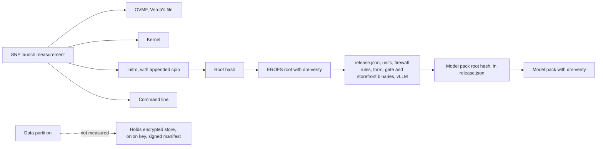
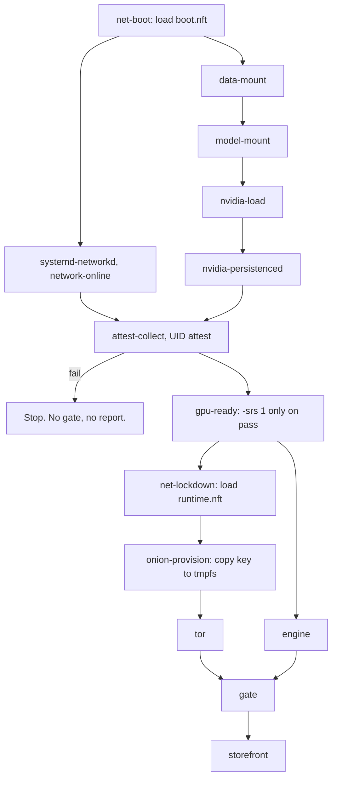
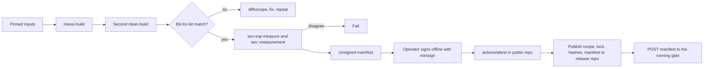
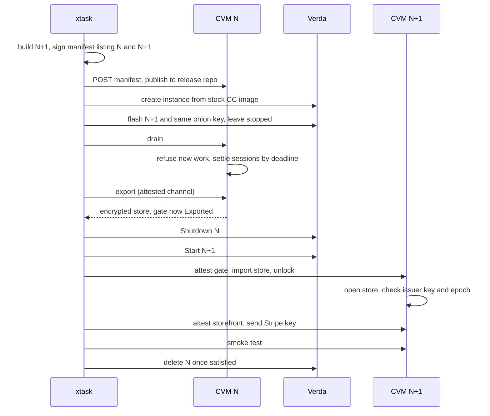

# 07. Enclave image and deployment

This covers what goes in the measured image, how it boots, how a release is built and signed, and how it reaches Verda and gets updated. **No custom image has booted on Verda yet.** The layout below follows Verda's own encrypted-image scripts, read but not run, and [milestone M0](08-decisions-and-validation.md#5-milestones) checks the assumptions most likely to change it. [ARCHITECTURE.md section 12](../../ARCHITECTURE.md#12-image-and-deployment) is the authority, and where the two disagree, it wins.

## 1. What is measured

SEV-SNP measures the initial guest state. On Verda, that's OVMF plus, through OVMF's hashes table, the kernel, initrd and command line, read from the instance's own volume. [read in Verda's scripts, inferred for this image]



The root hash goes in an appended initrd, because Verda seems to derive the command line itself, which rules out mkosi's normal `roothash=` route. The initrd opens verity from its own copy of the hash and ignores the root given on the command line. The manifest still pins the exact command line, since it's in the measurement. [read, origin of the command line unknown]

**What isn't measured** is the data partition. Everything there is either encrypted (the store), not secret (the onion key), or signed (the manifest), and the guest kernel parsing it is [accepted limit 9](01-system-and-data-flow.md#accepted-limits). The onion key not being secret has a cost: the host can read it and front the service ([limit 15](01-system-and-data-flow.md#accepted-limits)).

## 2. Disk layout

| Partition | Filesystem | Contents | Written by |
|---|---|---|---|
| `bios` | None | BIOS boot | Build |
| `esp` | FAT | EFI, mirroring Verda's layout | Build |
| `boot` | ext4, fixed UUID | `vmlinuz`, `initrd.img` symlinks, and a `lib/systemd` marker relative to this partition's own root | Build |
| `root` | EROFS | Read-only OS | Build |
| `root-hash` | dm-verity tree | Hash tree for root | Build |
| `model-0` | EROFS plus verity, as one modelwrap pack | Qwen3-0.6B | Build |
| `data` | ext4, 20 GB placeholder | Onion key, encrypted store, signed manifest | Operator's copy of the disk image before flashing, then gate |

Verda's extractor looks for `sbin/init|lib/systemd` to choose a partition, and its marker comment reads "makes Verda pick /boot as 'root'". An EROFS root might be picked instead, which would change `root=UUID` and hence the measurement. That's the first thing M0 tests. [read]

The model is a partition because whether extra volumes attach to CC instances is unknown. Adding a model later means a new image, and this is deliberate: the catalogue is measured.

## 3. Build tree

```text
image/
├── mkosi/
│   ├── mkosi.conf             Distribution=ubuntu, Release=noble, Snapshot, Seed, SourceDateEpoch
│   ├── mkosi.repart/          our RepartDirectories, Verity=data and Verity=hash
│   ├── mkosi.packages/        hash-pinned debs: tor, nvattest, libnvat, NVIDIA driver
│   ├── mkosi.postinst         update-initramfs inside the image
│   └── mkosi.postoutput       copy initrd, cpio, boot partition, disk assembly
├── initrd/
│   └── local-bottom/open-root open verity from embedded hash, swap root
├── units/
│   ├── net-boot.service       systemd-networkd config, data-mount.service
│   ├── model-mount.service    nvidia-load.service
│   ├── nvidia-persistenced.service
│   ├── attest-collect.service gpu-ready.service
│   ├── net-lockdown.service   onion-provision.service
│   ├── tor-gate.service       engine.service    gate.service
│   ├── storefront.service
├── etc/
│   ├── resolv.conf            static, public resolver, in the measured root
│   ├── modprobe.d/nvidia-lkca.conf
│   └── tmpfiles.d/counteractive.conf
├── net/
│   ├── boot.nft               runtime.nft
├── tor/torrc
├── engine/                    uv.lock, pyproject.toml
├── model/                     modelwrap pin, mount script
├── boot/
│   ├── attest-collect.sh      gate snp-ids, curl, nvattest
│   └── onion-provision.sh
└── release.template.json      checked in. xtask generates release.json from it.

deploy/
├── verda.py                   instance create, start, shutdown, volume actions
├── flash.sh                   runs in the RAM-only stage
└── dropbear-hook/             pause hook for that stage
```

**Base.** Ubuntu 24.04 is Verda's stated default and one of NVIDIA's two supported releases. Kernel modules are the prebuilt `linux-modules-nvidia-*` from Ubuntu's `restricted`, so no DKMS compile happens at install. `nvidia-persistenced` comes from the driver's utility packages, probably `nvidia-compute-utils-*`. The exact names and versions are copied from `dpkg -l` on a stock instance, because a RIM must exist for the driver in use. Verda's docs show driver 580.126.09. [read for the base and driver, inferred for the package name]

**mkosi** v27.1 with `Bootable=no`, `Verity=hash`, `SplitArtifacts=`, `Ssh=never` and our own `RepartDirectories`. The default repart definitions don't add verity for this layout. `Bootable=no` also yields no default initrd, and `local-bottom` is an initramfs-tools hook, so `mkosi.postinst` runs `update-initramfs` and `mkosi.postoutput` copies the result. `Initrds=` is the alternative. It gets two days. If kernel extraction, the initrd or double-build matching fights back, switch to `mmdebstrap` with `mkfs.erofs -T0` and `veritysetup format`, which has a stated bit-for-bit claim. [read]

**A bring-up variant** is needed, because this image has no way to see why it failed: Tor starts only after attestation and lockdown, so an early failure looks like an instance that never appears. The variant uses the same recipe with debug SSH added, has its own measurement, and is never listed in a signed manifest. M5 and M6 say which image each result came from, and any result from the variant is re-tested on the final image.

## 4. Boot order



| Unit | Runs as | Network | Job |
|---|---|---|---|
| `net-boot` | root | None | Loads `boot.nft` before any interface comes up |
| `systemd-networkd` | `systemd-network` | Boot rules | DHCP on the instance's interface, with `network-online.target` waiting for it. `/etc/resolv.conf` is a static file in the measured root, so the `attest` UID, and later the `storefront` UID, resolve directly. M0 confirms that external DNS works. |
| `data-mount` | root | None | Mounts `data` with `nosuid,nodev,noexec`. Fails closed. |
| `model-mount` | root | None | Opens the model pack with the root hash from `release.json` and mounts it read-only. Fails closed. |
| `nvidia-load` | root | None | Loads the driver and UVM with `/etc/modprobe.d/nvidia-lkca.conf` present, and creates device nodes. NVIDIA requires the Linux Kernel Crypto API in every CC mode. |
| `nvidia-persistenced` | `nvidia-persistenced` | None | `--user nvidia-persistenced --uvm-persistence-mode --verbose`. Without it, driver teardown destroys the SPDM keys, and the GPU won't work again until a function-level reset. M0 reads the stock unit's flags. [read in NVIDIA's guide] |
| `attest-collect` | `attest` | Boot rules | See below. Writes `/run/evidence/`, then exits. |
| `gpu-ready` | root | None | `nvidia-smi conf-compute -srs 1`, only after a pass. Current `nvattest` no longer does this. [read] |
| `net-lockdown` | root | None | Atomically replaces rules with `runtime.nft` |
| `onion-provision` | root | None | Copies the onion key from `data` to a tmpfs `HiddenServiceDir`, mode 0700, owned by tor |
| `tor-gate` | `debian-tor` | Runtime rules | The onion service |
| `engine` | `engine` | `PrivateNetwork=yes` | vLLM on a Unix socket |
| `gate` | `gate` | `PrivateNetwork=yes` | Holds `/dev/sev-guest`, `/run/gate/gate.sock`, `/run/issue/issue.sock` and the engine socket |
| `storefront` | `storefront` | Runtime rules: in on TCP 8443, out to ports 53 and 443 | Attested TLS on TCP 8443, Stripe client, `issue.sock` client. `After=gate.service`, `ProtectSystem=strict`. |

**Runtime directories**, from `tmpfiles.d`:

| Path | Mode and owner | Why |
|---|---|---|
| `/run/gate` | `0750 gate:debian-tor` | tor connects to `gate.sock`, which is `0660` with group `debian-tor` |
| `/run/issue` | `0750 gate:issue` | The storefront connects to `issue.sock`, which is `0660` with group `issue`. Only `storefront` is in that group. |
| `/run/evidence` | `0750 attest:evidence` | Collector writes. Gate and storefront read, as members of `evidence`. |
| `/run/engine` | `0770 engine:gate` | Gate connects to the engine's socket |
| `/run/tor-gate` | `0700 debian-tor` | tor's data and onion key |

`/dev/sev-guest` is reachable by `attest`, `gate` and `storefront` through a group set by a udev rule. The storefront needs it for its own reports, since it binds its own TLS key with role `storefront`.

The `storefront` user isn't in `debian-tor` and has no access to `/run/gate/gate.sock`, the store or the engine socket.

**The collector.**

1. `gate snp-ids`, a subcommand using `sev` and run as `attest`, prints the chip ID and TCB, and any certificates in the extended report. `snpguest` isn't in the final image.
2. `curl` fetches the VCEK from AMD if the extended report had none. The CRL is always fetched.
3. `nvattest collect-evidence --nonce N --format json > gpu.json`.
4. `nvattest attest --gpu-evidence-source file --gpu-evidence-file gpu.json --nonce N --verifier local --relying-party-policy P`.

The gate hashes exactly `gpu.json`, so the file bound into reports is the file that was appraised. These flags exist, but whether the file reader accepts the collected format, and whether `nvattest` works without root, are untested. M0 tries both.

**Failure and restart.**

- All boot oneshots use `RemainAfterExit=yes`, and `Requires=` and `After=` chains among them fail closed. If GPU appraisal or evidence fetching fails, no report can ever be produced, because neither the gate nor the storefront can start: both require that chain. `JoinsNamespaceOf=` isn't used.
- `gate`, `engine`, `tor-gate` and `storefront` use `Restart=on-failure`. A gate restart re-locks it, and an operator must unlock again. A storefront restart loses its Stripe key, which it holds in memory only, so it comes back `unconfigured` and needs configuring again.
- `gate` has `Wants=` and `After=` on `engine` and `tor-gate`, not `Requires=`, so an engine restart doesn't also lose every live session. Neither unit gates a security check.
- A kill test restarts the gate after lockdown, and checks that the firewall ruleset is unchanged and that no boot unit ran again.
- If a boot unit fails, a one-line status naming it goes on `data`. Otherwise the final image gives no clue, because it has no SSH. The operator reads it from the volume. Serial access on Verda CC is unknown, and M0 checks it.

**Evidence ages with uptime.** After lockdown, the guest can't re-fetch anything. The CRL's accepted age must cover the time between updates, and GPU evidence is from boot, not per-request. OCSP freshness also relies on the guest's clock, which the host controls, since Verda's guest features 0x1 suggest no Secure TSC. A host forcing a failure costs only availability, though a host faking time could present an expired OCSP response as fresh. [inferred]

**A contract clause may conflict with this.** Verda's terms, Schedule 4, say to "refresh cached output of NVIDIA Confidential Computing at least once in any twenty-four (24) hour period". [read] A guest locked to Tor can't refresh anything. Whether this binds a tenant's boot-time appraisal is a question for Verda, to ask before any instance runs past 24 hours. Until there's an answer, the operator restarts at least every 24 hours, with an unlock and an outage each time. The wallet doesn't check evidence age, since that wouldn't answer the contract question ([limit 18](01-system-and-data-flow.md#accepted-limits)).

**What this image lacks** is `sshd`, a login shell for any service, cloud-init, and any path from the gate to a privileged helper.

## 5. Firewall

Inbound is dropped at boot, and at runtime everything is dropped except the storefront's TCP 8443, because Verda doesn't filter inbound on public IPs. [read]

```text
# boot.nft: DHCP for all, DNS and HTTPS from one user
table inet filter {
  chain input   { type filter hook input priority 0; policy drop;
    iif lo accept; ct state established,related accept; udp sport 67 udp dport 68 accept }
  chain output  { type filter hook output priority 0; policy drop;
    oif lo accept; udp sport 68 udp dport 67 accept;
    meta skuid "attest" udp dport 53 accept;
    meta skuid "attest" tcp dport { 53, 443 } accept }
  chain forward { type filter hook forward priority 0; policy drop; }
}

# runtime.nft: the storefront port in; out only for tor, the storefront's DNS and HTTPS, and DHCP renewal
  chain input   { type filter hook input priority 0; policy drop;
    iif lo accept; ct state established,related accept;
    udp sport 67 udp dport 68 accept; tcp dport 8443 accept }
  chain output  { type filter hook output priority 0; policy drop;
    oif lo accept; udp sport 68 udp dport 67 accept;
    meta skuid "debian-tor" meta l4proto tcp accept;
    meta skuid "storefront" udp dport 53 accept;
    meta skuid "storefront" tcp dport { 53, 443 } accept }
```

Hostnames aren't filterable in nftables, so the boot stage allows HTTPS anywhere for the `attest` user, and the runtime ruleset does the same for the `storefront` user, which needs only Stripe's API. Only measured code runs under those UIDs. Gate and engine keep `PrivateNetwork=yes`, so the storefront's rules can't reach them. DHCP stays in the runtime ruleset so a lease renewal doesn't cut the service off, though Verda's lease behaviour is unknown. The ruleset's syntax is a sketch, not tested.

**Legacy public IP.** Verda's private-only option has no internet access and is beta, and the combination of public plus private hasn't been tested on CC. The guest firewall does the work. [read]

**Inbound port and IP.** Whether an inbound port beyond SSH reaches a CC instance, and whether its public IP survives Shutdown and Start, are M0 checks. Wallets reach the storefront at a compiled-in address. If the IP changes, wallets need a DNS name pinned instead, which still needs no certificate. [unknown] This is [limit 23](01-system-and-data-flow.md#accepted-limits).

## 6. Service configuration

### torrc

```text
SocksPort 0
ControlPort 0
DataDirectory /run/tor-gate/data
HiddenServiceDir /run/tor-gate/hs
HiddenServiceVersion 3
HiddenServicePort 443 unix:/run/gate/gate.sock
HiddenServiceMaxStreams 8
HiddenServiceMaxStreamsCloseCircuit 1
HiddenServiceEnableIntroDoSDefense 1
HiddenServicePoWDefensesEnabled 1
CompiledProofOfWorkHash 0
Sandbox 1
```

The unit adds `MemoryDenyWriteExecute=yes`, which is why the compiled proof-of-work hash is off. Reload via HUP isn't used. The image's tor is 0.4.9.16 from `deb.torproject.org`, hash-pinned and archived with its source, with 0.4.9.14 as the minimum because of bug 41434. A build test asserts `tor --list-modules` includes the required modules. [read, bug number from the Tor survey]

**Tor releases force updates.** The project ships about every two weeks. A rule keeps this from turning into constant redeployment: update for security fixes affecting clients or onion services. Skip a release with a one-line reason otherwise. For example, 0.4.9.16 touched only directory authorities.

C tor calls `exit(1)` when a consensus lists a required protocol it lacks. Recommended-version lists only warn. [read in `networkstatus.c`] This exit recurs at each consensus, so `Restart=on-failure` doesn't fix it, and the service becomes unreachable, including for an operator export. `xtask probe` checks a public health endpoint from outside and raises an alarm. The fix is a new image, and the store comes off the volume by the [unreachable-gate path](#if-the-gate-cant-be-reached).

### Engine

```text
vllm serve /models/qwen3-0.6b \
  --uds /run/engine/engine.sock \
  --disable-prefix-caching \
  --enable-force-include-usage \
  --override-generation-config '{"max_new_tokens": 4096}' \
  --disable-uvicorn-access-log \
  --disable-fastapi-docs
```

| Setting | Why |
|---|---|
| `VLLM_NO_USAGE_STATS=1`, `DO_NOT_TRACK=1`, `HF_HUB_OFFLINE=1` | No outbound attempts, and telemetry stays off even if the namespace changes |
| `PrivateNetwork=yes`, `UMask=0007`, restricted socket directory | vLLM has no socket permission setting of its own. Interaction with the NVIDIA stack is unknown. |
| Caches on tmpfs | Nothing reaches the plain disk |
| uv hash lock, Python 3.12, CUDA 13.0 wheels on `cuda13.2.cc` | Reproducible. Whether this matches the driver is open: CUDA 13.2 is tied to driver 595, and Verda's docs show 580.126.09. M0's `dpkg -l` settles which wheels to pin. [inferred] |
| No reasoning parser | Thinking off through the template, which the gate sets |
| FlashInfer disabled first | Fewer moving parts |

Prefix caching is off across the service. Session-scoped `cache_salt` is a later optimisation. This costs more per turn: the 4 KB prompt in the metering test showed reuse would save work, but sharing it across sessions opens a side channel.

Nobody has yet run vLLM 0.33.0 with this model under GPU-CC. M6 does.

### Model pack

`modelwrap` v0.3.0 packs Qwen3-0.6B at commit `c1899de289a0` into a deterministic EROFS plus verity file. `.info` gives `ROOTHASH_OFFSET_VERITYUUID`. Those values enter `release.json`, and a mount script runs `veritysetup open --no-superblock` with the spec's parameters. Only safetensors load: a model pack "can still contain malicious model code or data", in the modelwrap spec's words.

### Storefront

| Setting | Why |
|---|---|
| `User=storefront`, `After=gate.service` | Its own process and user, started once the gate exists. Issuance still waits for the gate to be Ready. Like the gate, it requires the boot chain, so it never starts after a failed appraisal. |
| `ProtectSystem=strict` | It writes nothing durable |
| Supplementary groups `issue` and `evidence` | Connects to `issue.sock`, and reads the boot evidence for its own reports |
| Listens on TCP 8443 | The one clearnet inbound port. Inner TLS with a per-start key, bound into an SNP report with role `storefront`. |
| Stripe key held in memory only | It arrives from `xtask unlock` after each start ([06 section 5](06-component-storefront.md#5-operator-configuration)) |

### `release.json`

```json
{
  "schema": 1,
  "image_version": "0.1.0",
  "service_id": "counteractive-poc",
  "minisign_public_key": "RW...",
  "k_sha256": "hex",
  "balance_width": 24,
  "products": [
    {"id": "usd-5", "usd_cents": 500, "credits": 5000000}
  ],
  "storefront": {"port": 8443, "operator_token_sha256": "hex"},
  "session_policy": {
    "maximum_spend": 500000, "idle_seconds": 900, "max_turns": 64, "max_age_seconds": 3600
  },
  "catalogue": [
    {
      "id": "qwen3-0.6b",
      "engine": "vllm",
      "usage_trust": "inside_attested_boundary",
      "model_commit": "c1899de289a0",
      "tokenizer_sha256": "hex",
      "template_sha256": "hex",
      "pack_root_hash": "hex",
      "pack_offset": 0,
      "input_rate": 1,
      "output_rate": 3,
      "max_output": 4096,
      "context": 32768
    }
  ]
}
```

All values shown are placeholders. Changing a price, a product or a model means a new image, which keeps "what am I being charged" part of what's attested. The tradeoff is that price changes are slow, which suits a PoC. The storefront sends each product's `usd_cents` to Stripe inline as `price_data`, so no Stripe Price objects exist, and the gate refuses a `credits` value that isn't a listed product. `operator_token_sha256` pins the token that configures the storefront, as `k_sha256` pins K.

## 7. Release and manifest

### Pipeline



Both measurement tools run for 30 vCPUs. Two CPU signatures are computed, 26/0/0 and 26/2/1, until a real report settles Verda's conflicting statements. `sev::measurement` can't express 26/2/1, so the cross-check only applies to 26/0/0. Neither tool has been compared to a real Verda report, though `sev-snp-measure` reproduced 4 of 4 Tinfoil reports. [tested for Tinfoil, unknown for Verda]

**The binary image isn't published**, because of NVIDIA's redistribution limits. Auditors rebuild from the recipe, which is a real cost: they need the same base packages, and they must accept NVIDIA's terms.

**The signing key stays offline.** CI doesn't hold it. Minisign's signature is on canonical JSON with sorted keys and no whitespace, and `allow_legacy=false` on the verifier. `actions/attest` needs a public repository, and the wallet doesn't check its output, so the log is **for auditing only**.

**Wallets get the manifest from the gate over Tor, or from the storefront during a purchase.** The release repository is for auditors. At use time a wallet fetches only over Tor, so a manifest fetch is never a use-linked request from a user's real IP. During a purchase the user is already identified. Either way the manifest stays pending until the user approves it.

### Manifest

The manifest lives outside the image, and it's what the wallet trusts. Multiple releases can be listed at once for updates, and each release has its own platform, so a Tinfoil entry could sit beside a Verda entry.

```json
{
  "schema": 1,
  "version": 7,
  "service": {
    "id": "counteractive-poc",
    "onion": "....onion",
    "credit_scheme": "ec-act-p256-v0",
    "issuer_public_key": "base64url",
    "key_epoch": 1,
    "balance_width": 24
  },
  "releases": [
    {
      "image_version": "0.1.0",
      "platform": "snp-verda",
      "attestation_policy": {
        "kind": "snp",
        "tcb_floor": {"fmc": 0, "bootloader": 0, "tee": 0, "snp": 0, "microcode": 0},
        "guest_policy": "0x..."
      },
      "release_config_sha256": "hex",
      "release_config": {},
      "measurements": [
        {
          "digest": "hex",
          "sku": "1RTXPRO6000.30V.CC",
          "not_after": "2026-12-31",
          "host_inputs": {
            "ovmf_sha256": "fea1855b...",
            "cmdline": "...",
            "vcpus": 30,
            "vcpu_sig": [26, 0, 0],
            "guest_features": "0x1"
          }
        }
      ]
    }
  ]
}
```

`fmc` is in the floor because Turin's TCB format includes it. [read]

`service` names no storefront address. That address is compiled into the wallet beside the onion address, because a manifest can't be allowed to choose where a wallet connects. Products and prices come from the attested `release_config`. Gate and storefront run in one image, so they share one measurement, and the role bound into each report tells them apart.

**`key_epoch`** names one issuer key. A new epoch means a new key, which voids every existing chain, because credentials are bound to the context and the key. Wallets accept only epochs compiled in, so changing epoch needs a new wallet release. The PoC stays at 1.

| Rule | Who checks |
|---|---|
| `version` only goes up | Wallet, and the gate through `issuer.manifest_version` |
| `service.id`, `service.onion` and `service.key_epoch` equal compiled-in values | Wallet, which stops per-user contexts |
| `credit_scheme` known, `issuer_public_key` present | Wallet |
| Unknown platforms skipped, refused only if no usable release remains | Wallet |
| The measurement in a report selects a release, and products, prices and catalogue come from that release | Wallet |
| Fetched manifest stays pending until the user approves it | Wallet |
| Own measurement selects a release whose `release_config_sha256` equals the local `release.json` | Gate |
| `issuer_public_key` and `key_epoch` equal the store's | Gate |

```text
ctx_cred  = SHA-256("counteractive-cred-v1"  || u8 len || service_id || u32be key_epoch)
ctx_spend = SHA-256("counteractive-spend-v1" || u8 len || service_id)
```

The length prefix stops one `service_id` and epoch colliding with another. These values appear in no manifest: the wallet computes them from its compiled-in values, and the gate from `release.json` and the store.

Any change to Verda's OVMF or command line makes every wallet refuse, until a new manifest is published and approved. This fails closed, and it's a real availability risk. It's also the reason for `not_after`: an entry can't stay trusted indefinitely after a TCB problem.

**One signer can give one wallet a private manifest and a private release.** Since the wallet doesn't enforce a log, nothing in the PoC would detect this ([accepted limit 5](01-system-and-data-flow.md#accepted-limits)).

## 8. First deployment

**Prerequisites.** A Verda account, `xtask` built locally, and a Stripe sandbox account with a restricted key. Generate these offline first, because the image pins or carries them:

| Secret | Generated with | Pinned in the image as |
|---|---|---|
| Minisign key | `minisign -G` | Public key. Also compiled into wallets. |
| K | `xtask keygen`, 32 random bytes | `SHA-256(K)` |
| Storefront operator token | `xtask keygen` | `operator_token_sha256` in `release.json` |
| Onion key | Stock `tor` once, offline | Nothing. Address goes in the manifest and is compiled into wallets. |
| Stripe restricted key | Stripe's sandbox Dashboard | Nothing. Sent to the storefront at each unlock and held in memory. |

**Billing.** A zero Verda balance discontinues instances and deletes volumes, restorable for up to 96 hours. The money store is on that volume, so this is a data-loss path as well as an outage. $100 lasts about 36 hours at $2.78/h. Turn on auto top-up or an alert. Verda recommends keeping at least 12 hours of usage. [read]

**Steps.**

1. Build the release. Sign a bootstrap manifest with no issuer key. Wallets refuse this manifest, and `xtask unlock --init` accepts it, since no issuer key exists yet.
2. Create an instance:
   ```text
   POST /v1/instances
   { "instance_type": "1RTXPRO6000.30V.CC", "location_code": "FIN-03",
     "image": <stock CC image>, "ssh_key_ids": [...], "contract": on-demand }
   ```
   The stock image slug is unknown until `GET /v1/images` runs with a token. A Verda script of about 150 lines covers this because the SDK and Terraform provider lack the network fields. `verda-cli` is enough for manual steps.
3. Enter the RAM-only stage. Install `dropbear-initramfs` and a pause hook on the stock system, then Shutdown and Start. An in-guest reboot won't bring the instance back. [read]
4. `xtask flash` writes the onion key into `data` in the operator's local copy of the disk image, then sends it through that stage: `gzip -d | dd of=/dev/vda`. Shut down, then Start. SSH never exists in the final image, and attestation only covers the final boot, so nothing here needs trusting.
5. Boot units run. Wait for the onion descriptor to publish.
6. `xtask unlock --init`: attest against the bootstrap manifest, then send K. The gate checks `SHA-256(K)`, creates the store, generates the seed with `generate_seed` and `from_seed`, commits, and returns the public key. It enters `AwaitingManifest`. If this crashes, repeating the command returns the same key, because the store is durable.
7. `xtask manifest --issuer-key <pk>`. Sign offline. Publish it to the release repo and send it through `POST /v1/operator/manifest`. The gate checks the key, epoch and config hash, then moves to Ready.
8. `xtask unlock` configures the storefront: it attests the storefront over clearnet on TCP 8443 against the new manifest, with role `storefront`, then sends the Stripe restricted key with the operator token. The storefront checks the token's hash against `release.json` and becomes ready.
9. Build a wallet release with the compiled-in pins from [04 section 1](04-component-wallet.md#1-process-model), including the storefront address.
10. Smoke test with a sandbox purchase on a test card, collect, one chat, close and `reconcile`. Then Shutdown and Start, unlock the gate and configure the storefront, and confirm the balance and a `recover`.

**Costs.** $2.78/h, about $2,030 for 730 hours, on demand, in FIN-03. Shutdown still bills. Use spot at $1.39/h for measurement tests only, as it can be evicted without warning and the service can't restart unattended. [read in the console, 2026-11-06]

**Restart.** Every Shutdown and Start needs `xtask unlock`, which unlocks the gate and then configures the storefront. This is accepted limit 11. Purchases are refused until both are done. Whether the public IP, and so the storefront address in every wallet, survives a Shutdown and Start is unknown until M0 ([section 5](#5-firewall)).

**B200.** The only B200 CC size actually available was 8x, `8B200.240V.CC.AMD`, at $74.566/h, or $37.283/h on spot. It has a different vCPU count (240), hence a separate measurement entry. Start with RTX PRO 6000 CC, since nothing in the design needs eight GPUs. Whether Qwen3-0.6B even benefits is doubtful. The 1x B200 on the pricing page isn't a rentable size. [read]

## 9. Updating a running service

The final image has no SSH, so a running disk can't be rewritten. Updates move state to a new instance. Only the gate's store moves. The storefront has no state, so on N+1 it only needs its Stripe key again.



**Rules:**

1. Both instances must never run together with the same onion key. Tor's behaviour would be unpredictable, and a wallet could reach either.
2. Export takes a consistent copy with SQLite's backup API or `VACUUM INTO`, only once Draining has no live sessions. Sealed results and spent sets travel with it. A session that outlives the drain deadline is closed by the gate, and its wallet recovers from N+1. Once the copy starts, gate N is Exported and won't commit anything else ([05 section 2](05-component-gate.md#2-boot-state-machine)).
3. The store stays encrypted under K throughout, including on the operator's disk.
4. The first signed manifest lists N and N+1. A later one drops N, which stops wallets accepting a rollback to it.
5. **Failure before any wallet traffic** on N+1: shut it down and Start N again. N comes back Locked, and its own store is still current, so a plain unlock works, followed by configuring N's storefront.
6. **Failure after traffic** on N+1: drain and export from N+1 if possible. Shut N+1 down, Start N, and use `xtask unlock --state --replace`. N is Locked, so the import moves `current` to a new store generation, which leaves N's old `-wal` with the old store ([05 section 3](05-component-gate.md#3-api)). If N+1 can't export, unlock N on its old store. That's a rollback, and it carries limit 8's risk.

**What a user sees.** New sessions are refused during the drain, for up to 15 minutes, followed by export, boot and unlock. That total hasn't been measured. Purchases are refused while the gate isn't Ready: collect returns `503 locked`, and a paid order stays collectable. Afterwards a new SPKI forces re-attestation, for the gate and the storefront. Balances don't change. A wallet whose accepted manifest doesn't list N+1 fetches the new one, over Tor or during a purchase from the storefront, and asks its user to approve it. It can't use the service until then.

**Costs and unknowns.** Two instances bill during the window, because stopped ones still bill, and that window may be an hour. It needs a free GPU in FIN-03, and capacity can run out. A golden volume might shorten the flash step, though API behaviour for customised volumes is unknown. N+1 is a new instance, so its public IP may differ from N's while wallets have the storefront address compiled in. Whether an IP can move between instances is unknown. If it can't, the pinned DNS name from [section 5](#5-firewall) is needed here too. [unknown] **This path has never been run**, and M7 tests it. Store size for the transfer over Tor should be small for a PoC.

### If the gate can't be reached

A required-protocol exit from tor, or a broken image, leaves no attested channel for export. The store is still on the volume.

1. Shut down N.
2. Clone or detach its volume through the API, and read `data` from a helper instance.
3. Copy the SQLCipher file from the directory `current` names, together with its `-wal` file, to the operator's machine.
4. Open it with K and run `VACUUM INTO`, which folds in the WAL and gives one file.
5. On N+1, attest, then import it with `xtask unlock --state`.

Every session that was live becomes Pending with no slot, so those refund in full ([limit 12](01-system-and-data-flow.md#accepted-limits)). The host could supply an old volume here, which is the same rollback as limit 8. Whether CC volumes can be cloned or attached like this is unknown, so M0 and M7 test it. Without this path, the fallback is the last export, with rollback risk.

**Backups.** None automated. A backup is exactly a rollback risk, and a lost store loses all balances. The operator should keep the most recent export until the next one succeeds. It's fine for test money and would need real thought before live money.

## 10. What's deferred

| Item | Why deferred |
|---|---|
| dm-crypt with integrity under K for `data` | Needs a privileged unlock step, and it removes limit 9 |
| SNP derived-key wrap | Gives unattended restart on one chip. Doesn't hide K unless paired with a handoff. |
| Enclave-to-enclave handoff | Hides the issuer key from the operator, and takes two live instances and about 300 lines |
| Separate CPU CC VM for credit | Separates issuer key from GPU, at the price of an attested link and more services. Decision 1 keeps credit in the gate for the PoC ([ARCHITECTURE section 2](../../ARCHITECTURE.md#2-decisions)). |
| Browser-facing storefront page | Needs a domain name and a public certificate on port 443. The wallet's attested TLS needs neither. |
| Wallet-enforced transparency log | About 8,000 lines to reuse from `tinfoil-rs`, whose licence needs checking first, or a custom design |
| Wallet-side GPU evidence check | Proves a real GPU, not good firmware, so it adds little today |
| Constant-size frames | Should be measured first |
