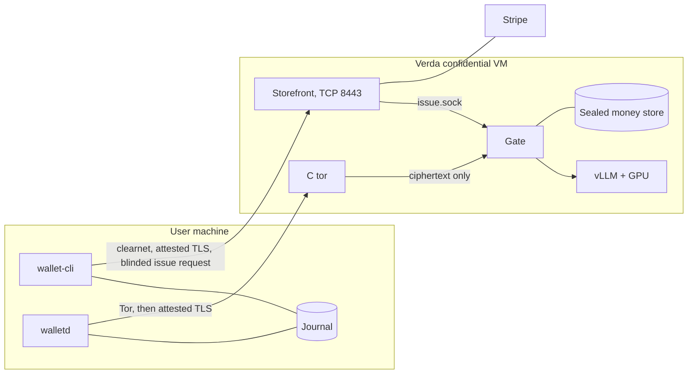

# Counteractive architecture: component detail

**Status: per-component detail for the decided architecture, revised 7 November 2026.** [`ARCHITECTURE.md`](../../ARCHITECTURE.md) is the top-level authority. These documents give the depth behind it, one component or concern at a time. Where they disagree, `ARCHITECTURE.md` wins. The interfaces the local prototype is built against are pinned in [`prototype/SPEC.md`](../../prototype/SPEC.md).

No custom image has booted on Verda, and the full path has never run there. The `act-rs` test ran on a laptop only. What the local prototype has shown is recorded in [ARCHITECTURE section 14](../../ARCHITECTURE.md#14-validation-status).

A user buys credit by card over ordinary HTTPS. The storefront, its own process inside the same confidential VM on Verda, confirms the payment with Stripe and asks the gate to issue an EC-ACT credential against the wallet's blinded request. The wallet holds the resulting hidden balance. Each conversation spends part of that balance, over Tor, into a session with the gate. The gate checks the spend, meters tokens exactly and returns the unused part as a new credential. The wallet only sends anything secret after checking AMD's attestation and the guest's record of NVIDIA's appraisal, inside its own TLS connection to the gate or the storefront. The signed manifest it checks against arrives over Tor, or from the storefront during a purchase, and applies only once the user approves it.

The purchase plane and the use plane meet only inside the gate, at issuance, and what crosses is a blinded EC-ACT issue request.

## Documents

| Document | Contents |
|---|---|
| [01 System and data flow](01-system-and-data-flow.md) | Components, external software at each step, who sees what, every flow including purchase and issuance over clearnet, network map, accepted limits |
| [02 Third-party dependencies](02-third-party-dependencies.md) | What we adopt and why, what we write, including the test fakes, pins, licence gates, what we rejected |
| [03 Code architecture](03-code-architecture.md) | Repository, layering rules, crates, key abstractions, test tiers, change recipes |
| [04 Wallet](04-component-wallet.md) | Processes, directories, journal, purchase and chain state machines, attestation check, failures, invariants, reconcile |
| [05 Gate](05-component-gate.md) | Directories, boot states, API on `gate.sock` and `issue.sock`, money store, issuance and session flows, TLS, limits, failures, invariants |
| [06 Storefront](06-component-storefront.md) | The storefront inside the CVM: API, Stripe Checkout and payment confirmation by polling, the collect checks, the `issue.sock` client, failures |
| [07 Enclave image and deployment](07-enclave-image-and-deployment.md) | Measurement, partitions, boot order, units including the storefront's, firewall, config, release, first deployment, updates |
| [08 Decisions and validation](08-decisions-and-validation.md) | Decision log, EC-ACT fallback, the decisions taken and their costs, design rules, milestones, kill criteria, Tinfoil Containers as a target |

To read this quickly, start with `ARCHITECTURE.md`, then 01 sections 3 and 6, then 08 sections 3 and 5.

## Main choices

| Area | Choice |
|---|---|
| Credit | EC-ACT on P-256 through `act-rs`, held and verified by the gate inside the CVM. Fallback defined in 08. |
| Purchase | Stripe hosted Checkout, sandbox only. The storefront confirms payment by polling the Checkout Session, then asks the gate over `issue.sock` to issue, at purchase time. |
| Metering | Exact token charges, separate input and output rates, with a hold per turn |
| Transport | C tor service and embedded Arti client on the use plane; clearnet TCP to the storefront on the purchase plane; inner attested TLS 1.3 on both |
| Attestation | AMD SEV-SNP report per connection without a fresh verdict, bound to the server's role (`gate` or `storefront`), NVIDIA appraisal at boot, stapled evidence, signed manifest approved by the user |
| Key custody | Operator-delivered key K opens the encrypted store and the issuer seed. A K-holder can't read `t` from the store at rest, but can read issuance rows by order, nullifiers and pending state, recent commit order from the WAL, and per-nullifier time windows by comparing copies. `s` isn't stored, but most sessions use the top tier. A release signed by the same person sees everything. |
| Engine | vLLM with Qwen3-0.6B, on `InferenceBackend`, with a fake engine for tests and a small `llama-server` setup for development |
| Hosting | Verda `1RTXPRO6000.30V.CC`, FIN-03, on demand. Gate, storefront, tor and engine share the one instance. |
| Image | mkosi, Ubuntu 24.04, EROFS and dm-verity, no SSH |
| Client | `wallet-cli` for purchase and issuance, `walletd` with an OpenAI-compatible API and small page |
| Language | Rust, with a single locked workspace |

## Decisions taken on 7 November 2026

| # | Decision |
|---|---|
| 1 | EC-ACT credentials (`act-rs`), held and verified by the gate inside the CVM |
| 2 | Operator-held key K opens the money store and the issuer seed |
| 3 | The storefront runs on the same Verda instance, as its own process and user, on TCP port 8443, with attested TLS (role `storefront`), no domain and no public certificate |
| 4 | Stripe sandbox only |
| 5 | Rust for every component we write |
| 6 | Issuance on the purchase plane, over clearnet, at purchase time. The storefront confirms payment by polling the Checkout Session, then asks the gate over `issue.sock` to issue against the wallet's blinded issue request. |

[ARCHITECTURE section 2](../../ARCHITECTURE.md#2-decisions) states each with its consequence. [08 section 3](08-decisions-and-validation.md#3-decisions-taken) adds what each costs.

The modular backend goal, including Tinfoil Containers, is covered in [03 section 7](03-code-architecture.md#7-change-recipes) and [08 section 9](08-decisions-and-validation.md#9-tinfoil-containers-as-a-target).

## Evidence labels

Claims carry these tags wherever the difference matters.

| Tag | Meaning |
|---|---|
| `[tested]` | I ran it. Where matters, the conditions are stated, and most runs were on a laptop. |
| `[read]` | Read in source, documentation or a vendor console, and not run. |
| `[resolver]` | Cargo's resolver produced this dependency graph. Nothing was compiled. |
| `[inferred]` | My reasoning from the above. |
| `[unknown]` | Not settled. Usually paired with the milestone that settles it. |
| `[your decision]` | Comes from your scope instructions or the decisions you took on 7 November 2026. |

Supporting notes are in `research_notes/PoC architecture dependencies/` and `research_notes/Anonymous metered private inference/`.
